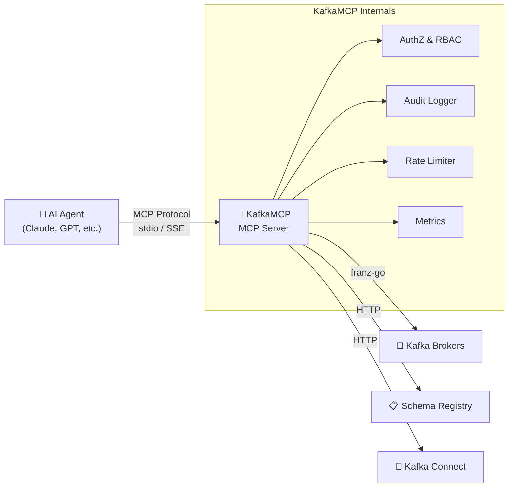

# KafkaMCP

> **Secure, vendor-neutral Kafka operations gateway for AI agents**

[](https://go.dev)
[](https://github.com/josedab/kafkamcp/actions/workflows/ci.yml)
[](https://codecov.io/gh/josedab/kafkamcp)
[](https://github.com/josedab/kafkamcp/blob/main/.github/workflows/ci.yml)
[](https://pkg.go.dev/github.com/josedab/kafkamcp)
[](LICENSE)

KafkaMCP exposes a curated, read-only-by-default MCP surface for Kafka topics,
messages, schemas, consumer groups, health, lag, and DLQs. Optional mutations
require verified identity, default-deny policy, and short-lived two-person
approval.

<!-- To generate a demo GIF: install vhs (https://github.com/charmbracelet/vhs), then run: vhs demo.tape -->

## Table of Contents

- [Features](#features)
- [Quick Start](#quick-start)
- [MCP Tools](#mcp-tools)
- [MCP Resources](#mcp-resources)
- [Security & Access Control](#security--access-control)
- [Observability](#observability)
- [SDKs & Editor Integrations](#sdks--editor-integrations)
- [Architecture](#architecture)
- [Examples](#examples)
- [Configuration Reference](#configuration-reference)
- [Development](#development)
- [Project Structure](#project-structure)
- [License](#license)
- [Troubleshooting](#troubleshooting)
- [Documentation & Community](#documentation--community)
- [Contributing](#contributing)
- [Security](#security)
- [Roadmap](#roadmap)

## Features

- **🔍 Topic Discovery** — List and describe topics, partitions, offsets, and configurations
- **📨 Consume Messages** — Read messages with flexible positioning (earliest, latest, offset, timestamp)
- **📤 Produce Messages** — Publish messages with delivery confirmation
- **📋 Schema Registry** — List and retrieve Avro/Protobuf/JSON schemas with human-readable field summaries
- **👥 Consumer Groups** — Inspect group state, members, partition assignments, and per-partition lag
- **🏗️ Cluster Metadata** — Browse brokers, controller, and cluster topology
- **🔒 Access Control** — YAML-based per-agent policies with default-deny semantics
- **📝 Audit Logging** — Structured JSON audit trail of all agent interactions
- **🔌 Dual Transport** — stdio (local/Claude Desktop) and SSE/HTTP (remote/multi-agent)
- **🏢 Multi-Cluster** — Connect to multiple Kafka clusters with per-cluster configuration
- **✅ Guarded Mutations** — Two-person approvals, policy simulation, blast-radius previews, and idempotency receipts

> **How does KafkaMCP compare?** See [`docs/COMPARISON.md`](docs/COMPARISON.md) for a sourced, date-stamped comparison against KIP-1318, Confluent, AWS MSK, Redpanda, Aiven, and Conduktor. The live documentation site is at [**josedab.github.io/kafkamcp**](https://josedab.github.io/kafkamcp/).

## Quick Start

> **One-command quickstart:** If you have Go and Docker installed, run `make quickstart` to install dependencies, start a local Kafka cluster, build KafkaMCP, and run it — all in one step.

### 1. Install

**From source:**
```bash
go install github.com/josedab/kafkamcp/cmd/kafkamcp@latest
kafkamcp version
```

Prebuilt binaries and `ghcr.io/josedab/kafkamcp` images will be available
after the first signed GitHub release. Until then, install from source. The
release workflow already generates checksums, SBOMs, Sigstore signatures, and
GitHub provenance attestations.

### 2. Configure

Generate a starter configuration:

```bash
kafkamcp init --output kafkamcp.yaml
```

This creates `kafkamcp.yaml` in the current directory. Edit it to match your
environment. See [`.env.example`](.env.example) for environment templates.

```yaml
server:
  transport: stdio        # stdio | sse | streamable-http
  log_level: info

clusters:
  - name: local
    bootstrap_servers: "localhost:9092"
    security_protocol: PLAINTEXT
    default: true

# Optional: Schema Registry
#   schema_registry:
#     url: "http://localhost:8081"

# Optional: Access Control
# policies:
#   default_deny: true
#   agents:
#     - id: "my-agent"
#       topics:
#         - pattern: "*"
#           permissions: [read, write]
#       consumer_groups:
#         permissions: [describe]
#       schemas:
#         permissions: [read]

audit:
  enabled: true
  max_entries: 10000
```

### 3. Connect to Claude Desktop

Add to your `claude_desktop_config.json`:

```json
{
  "mcpServers": {
    "kafkamcp": {
      "command": "kafkamcp",
      "args": ["--config", "/path/to/kafkamcp.yaml"]
    }
  }
}
```

### 4. Use

Once connected, your AI agent can:

```
"List all Kafka topics in my cluster"
```
> **Example response:** Found 12 topics: `orders.created` (6 partitions), `payments.completed` (3 partitions), `users.updated` (3 partitions), ...

```
"Show me the last 10 messages from the orders.created topic"
```
> **Example response:** 10 messages from `orders.created` (partition 2, offsets 4521–4530):
> ```json
> {"order_id": "ord-9842", "customer": "acme-corp", "amount": 149.99, "status": "created"}
> {"order_id": "ord-9843", "customer": "globex", "amount": 89.50, "status": "created"}
> ...
> ```

```
"Describe the consumer group order-processor and show me the lag"
```
> **Example response:** Consumer group `order-processor` — State: **Stable**, Members: 3, Total lag: **142 messages**
> | Topic | Partition | Current Offset | End Offset | Lag |
> |-------|-----------|---------------|------------|-----|
> | orders.created | 0 | 4510 | 4532 | 22 |
> | orders.created | 1 | 4488 | 4529 | 41 |

```
"What schema does the payments.completed topic use?"
```
> **Example response:** Subject `payments.completed-value` (Avro, version 3, BACKWARD compatible):
> Fields: `payment_id` (string), `order_id` (string), `amount` (double), `currency` (string), `processed_at` (long/timestamp-millis)

```
"Publish a test message to the test-events topic"
```
> **Example response:** ✅ Message delivered to `test-events` partition 0 at offset 847 (timestamp: 2025-01-15T10:32:01Z)

## MCP Tools

KafkaMCP exposes **29 supported tools** through three explicit packs:

| Pack | Stability | Purpose |
|---|---|---|
| `core-read` | Stable | Default set of 15 read-only Kafka inspection and diagnosis tools |
| `ops-write` | Beta | Real Kafka and Connect mutations, protected by verified identity, default-deny policy, two-person approval, and optional idempotency receipts |
| `governance` | Beta | Approval lifecycle, policy simulation, ACL planning, and tamper-evident decision export |

Every shipped tool performs real behavior. KafkaMCP ships **no simulated or
placeholder tools**: incomplete integrations stay out of runtime packs until
they have real implementations and integration tests.

The canonical, generated list and parameter reference is [docs/tool-reference.md](docs/tool-reference.md). The same generated content powers the [website API reference](https://josedab.github.io/kafkamcp/docs/api-reference/tools). Source files for archived feature experiments may remain during compatibility work, but tools outside these packs are not registered or callable.

The guarded `ops-write` and `governance` packs are rejected on stdio. They
require SSE or streamable HTTP, a cryptographic identity provider,
`default_deny: true`, header fallback disabled, and
`KAFKAMCP_APPROVAL_SIGNING_KEY` set to at least 32 bytes.

## MCP Resources

| Resource URI | Description |
|-------------|-------------|
| `kafka://cluster/metadata` | Cluster brokers, controller, topic/partition counts |
| `kafka://clusters` | All configured clusters for multi-cluster discovery |
| `kafka://topics` | Topic catalog with partition counts |
| `kafka://topics/{name}` | Individual topic detail |
| `kafka://schemas` | Schema Registry subject catalog |
| `kafka://schemas/{subject}` | Individual schema definition |
| `kafka://groups` | Consumer group catalog with state and lag |
| `kafka://groups/{id}` | Individual consumer group detail |
| `kafka://audit/log` | Agent audit trail (recent 1000 entries) |

## Security & Access Control

- **Per-agent authorization** — YAML policy engine with configurable default-deny and topic glob patterns
- **Rate limiting** — Token bucket per agent, configurable via policy
- **Verified network identity** — Static bearer tokens, OIDC, or mTLS; legacy identity-header fallback is rejected on network transports
- **Guarded mutations** — `ops-write` requires two-person, argument-scoped, single-use approvals with tamper-evident decision records
- **TLS policy** — Inbound MCP HTTPS requires TLS 1.3; Kafka and Connect clients default to TLS 1.2 for provider compatibility and can require TLS 1.3
- **TLS support** — HTTPS for SSE/HTTP transports via `tls_cert`/`tls_key` config
- **Audit logging** — Structured JSON audit trail (file + ring buffer)
- **Auth-filtered list results** — Agents only see resources they're authorized to access

## Observability

- **Prometheus metrics** at `/metrics` on `server.metrics_port` (default `3101`, bound to `server.metrics_host`, default `127.0.0.1`) — tool call counts, latencies, message throughput, auth denials, rate limit denials
- **Process liveness** at `/livez`, Kafka health at `/healthz`, and full readiness at `/ready`
- **Structured JSON logging** via `slog`
- **OpenTelemetry tracing** — optional OTLP export for distributed trace analysis (see [Telemetry config](#telemetry-opentelemetry))

## SDKs & Editor Integrations

| SDK / Integration | Path | Description |
|-------------------|------|-------------|
| **Go SDK** | [`sdk/go/`](sdk/go/) | Programmatic Go client for KafkaMCP — list topics, consume, produce, search |
| **Python LangChain** | [`sdk/python/kafkamcp_langchain/`](sdk/python/kafkamcp_langchain/) | LangChain toolkit — use Kafka tools in any LangChain agent |
| **Python CrewAI** | [`sdk/python/kafkamcp_crewai/`](sdk/python/kafkamcp_crewai/) | CrewAI tools — build Kafka-aware multi-agent crews |
| **Cursor Integration** | [`sdk/cursor/`](sdk/cursor/) | Native MCP support — configure `.cursor/mcp.json` and use all tools directly |
| **TypeScript SDK** | [`sdk/typescript/`](sdk/typescript/) | Type-safe async/await client for Node.js and TypeScript agents |

**Go SDK quick example:**
```go
import "github.com/josedab/kafkamcp/sdk/go/kafkamcpsdk"

client := kafkamcpsdk.New(transport)
topics, _ := client.ListTopics(ctx, "orders.*")
```

**Python LangChain quick example:**
```bash
pip install "git+https://github.com/josedab/kafkamcp.git#subdirectory=sdk/python/kafkamcp_langchain"
```
```python
from kafkamcp_langchain import KafkaMCPToolkit
tools = KafkaMCPToolkit(mcp_client=session)
```

**Python CrewAI quick example:**
```bash
pip install "git+https://github.com/josedab/kafkamcp.git#subdirectory=sdk/python/kafkamcp_crewai"
```
```python
from kafkamcp_crewai import StdioMCPClient, create_kafka_tools

with StdioMCPClient(args=["--config", "kafkamcp.yaml"]) as client:
    tools = create_kafka_tools(mcp_client=client)
```

## Architecture

> **📐 For a detailed architecture guide**, including package tiers, server lifecycle, and design decisions, see [**docs/ARCHITECTURE.md**](docs/ARCHITECTURE.md).

```
┌──────────────────────────────────────────────────────────┐
│                     KafkaMCP                              │
│                                                          │
│  ┌─────────────┐  ┌─────────────┐  ┌─────────────┐      │
│  │ AI Agent A  │  │ AI Agent B  │  │ AI Agent C  │      │
│  └──────┬──────┘  └──────┬──────┘  └──────┬──────┘      │
│         │ stdio          │ SSE            │ SSE          │
│         ▼                ▼                ▼              │
│  ┌──────────────────────────────────────────────┐        │
│  │              MCP Server Core                  │        │
│  │  Tools │ Resources │ AuthZ │ Audit │ Rate Lim │        │
│  └──────────────────────┬───────────────────────┘        │
│                         │                                │
│  ┌──────────────────────▼───────────────────────┐        │
│  │         Kafka Client (franz-go)               │        │
│  │  Admin │ Consumer │ Producer │ Schema Client  │        │
│  └──────────────────────┬───────────────────────┘        │
│                         │                                │
│         ┌───────────────┼───────────────┐                │
│         ▼               ▼               ▼                │
│  ┌──────────┐   ┌──────────────┐  ┌──────────┐          │
│  │  Kafka   │   │   Schema     │  │  Kafka   │          │
│  │  Brokers │   │   Registry   │  │  Admin   │          │
│  └──────────┘   └──────────────┘  └──────────┘          │
└──────────────────────────────────────────────────────────┘
```

### Component Flow



## Examples

The [`examples/`](examples/) directory contains ready-to-use configurations and sample agents:

| Example | Description |
|---------|-------------|
| [`confluent-cloud.yaml`](examples/confluent-cloud.yaml) | Connect to Confluent Cloud with SASL_SSL and Schema Registry |
| [`multi-cluster.yaml`](examples/multi-cluster.yaml) | Multi-cluster setup with per-agent access control policies |
| [`docker-compose.yaml`](examples/docker-compose.yaml) | Local Kafka + Schema Registry + KafkaMCP dev environment |
| [`masking.yaml`](examples/masking.yaml) | Data masking and PII redaction configuration |
| [`go-sdk/`](examples/go-sdk/) | Go SDK example — programmatic topic listing and message consumption |
| [`crewai-agent/`](examples/crewai-agent/) | CrewAI multi-agent crew with Kafka tools |
| [`langchain-agent/`](examples/langchain-agent/) | LangChain agent with KafkaMCP toolkit integration |

### Deployment

| Resource | Description |
|----------|-------------|
| [`deploy/helm/kafkamcp/`](deploy/helm/kafkamcp/) | Production-oriented Helm chart (Deployment, Service, HPA, PDB, NetworkPolicy, ServiceMonitor) |
| [`docs/PERSISTENCE.md`](docs/PERSISTENCE.md) | SQLite durability, atomic approval/idempotency transitions, and remaining volatile state |
| [`docs/PRODUCTION_CHECKLIST.md`](docs/PRODUCTION_CHECKLIST.md) | Pre-deployment security, state, network, observability, and rollback checklist |

## Configuration Reference

### Server
| Field | Type | Default | Description |
|-------|------|---------|-------------|
| `transport` | string | `stdio` | MCP transport: `stdio`, `sse`, `streamable-http` |
| `host` | string | `0.0.0.0` | Bind host for SSE/HTTP |
| `port` | int | `3100` | Bind port for SSE/HTTP |
| `metrics_host` | string | `127.0.0.1` | Bind host for metrics and `/livez`, `/healthz`, `/ready` |
| `metrics_port` | int | `port + 1` | Metrics and health/readiness port |
| `log_level` | string | `info` | Log level: `debug`, `info`, `warn`, `error` |
| `max_message_size` | int | `1048576` | Max MCP message size in bytes (1 MB default) |
| `tls_cert` | string | — | Path to TLS certificate for HTTPS |
| `tls_key` | string | — | Path to TLS private key for HTTPS |
| `tool_packs` | []string | `[core-read]` | Valid values: `core-read`, `ops-write`, `governance`. The guarded `ops-write` and `governance` packs require secure HTTP identity, default-deny, and signed approvals; stdio is core-read only. `essential` and `ops` are deprecated aliases. |
| `dangerously_allow_unauthenticated_network` | bool | `false` | **Local dev only.** Disables fail-closed guard for network transports. Never enable in production. |

### Clusters
| Field | Type | Required | Description |
|-------|------|----------|-------------|
| `name` | string | Yes | Cluster name |
| `bootstrap_servers` | string | Yes | Kafka broker addresses |
| `security_protocol` | string | No | `PLAINTEXT`, `SASL_PLAINTEXT`, `SASL_SSL`, `SSL` |
| `sasl_mechanism` | string | No | `PLAIN`, `SCRAM-SHA-256`, `SCRAM-SHA-512` |
| `sasl_username` | string | No | SASL username (supports `${ENV_VAR}`) |
| `sasl_password` | string | No | SASL password (supports `${ENV_VAR}`) |
| `ssl_ca_location` | string | No | Path to CA certificate bundle for SSL/TLS |
| `tls_min_version` | string | No | Minimum broker TLS version, `1.2` (default) or `1.3` |
| `schema_registry.url` | string | No | Schema Registry URL |
| `schema_registry.auth.username` | string | No | Schema Registry basic-auth username |
| `schema_registry.auth.password` | string | No | Schema Registry basic-auth password |
| `connect_url` | string | No | Kafka Connect REST API base URL |
| `connect_tls` | object | No | TLS settings for the Kafka Connect REST API |
| `connect_tls.ca_file` | string | No | Path to CA certificate for verifying the Connect REST API server |
| `connect_tls.insecure_skip_verify` | bool | No | Skip TLS certificate verification (default `false`) |
| `connect_tls.min_version` | string | No | Minimum Connect TLS version; defaults to `tls_min_version` |
| `default` | bool | No | Mark as default cluster |

### Policies
| Field | Type | Default | Description |
|-------|------|---------|-------------|
| `default_deny` | bool | `false` | Deny all access by default |
| `agents[].id` | string | — | Agent identifier |
| `agents[].role` | string | — | Agent role (e.g., `reader`, `writer`, `admin`) |
| `agents[].topics[].pattern` | string | — | Glob pattern (e.g., `orders.*`) |
| `agents[].topics[].permissions` | []string | — | `read`, `write`, `create`, `delete` |
| `agents[].consumer_groups.permissions` | []string | — | Consumer group permissions |
| `agents[].schemas.permissions` | []string | — | Schema Registry permissions |
| `agents[].rate_limit.requests_per_minute` | int | — | Max requests per minute for this agent |

### Approval (guarded packs)

> **`ops-write` and `governance` require all five conditions simultaneously; startup is rejected if any is missing:**
> 1. Transport must be `sse` or `streamable-http` — **stdio is core-read only**
> 2. `policies.identity.provider` must be `static`, `oidc`, or `mtls` (cryptographic identity)
> 3. `policies.identity.allow_header_fallback` must be `false` (default for cryptographic providers)
> 4. `policies.default_deny` must be `true`
> 5. `KAFKAMCP_APPROVAL_SIGNING_KEY` must contain ≥32 bytes
>
> Approval enforcement cannot be disabled when either guarded pack is active. Two-person approval is the default (`allow_self_approval: false`).

| Field | Type | Default | Description |
|-------|------|---------|-------------|
| `policies.approval.enabled` | bool | follows `default_deny` | Toggle enforcement. Cannot be `false` for guarded packs. |
| `policies.approval.ttl_seconds` | int | `300` | Default grant lifetime (seconds) |
| `policies.approval.max_ttl_seconds` | int | `3600` | Hard cap on grant lifetime |
| `policies.approval.single_use` | bool | `true` | Consume grant on first use |
| `policies.approval.allow_self_approval` | bool | `false` | Allow requester to approve their own grant. Defaults to false (two-person rule). |
| `policies.approval.signing_key_env` | string | `KAFKAMCP_APPROVAL_SIGNING_KEY` | Env var holding the HMAC-SHA-256 signing key (≥32 bytes) for tamper-evident decision records |
| `policies.approval.previous_signing_key_envs` | []string | `[]` | Previous ≥32-byte keys accepted during rotation |
| `policies.approval.terminal_retention_seconds` | int | `604800` | Retention for terminal/abandoned grants before pruning (max 30 days) |

**Approval grant lifecycle:** `request` → `approve` (by a different identity unless `allow_self_approval: true`) → `use`. Every transition and the current grant state are signed. Use `kafka_governance_decision` for `simulate`, `verify`, and `export`.

### Identity

> **Required for network transports.** `sse` and `streamable-http` transports refuse to start without a cryptographic identity provider (`static`, `oidc`, or `mtls`) and `policies.default_deny: true`, unless `server.dangerously_allow_unauthenticated_network: true` (local dev only). Identity header fallback is rejected by default for all cryptographic providers.

| Field | Type | Default | Description |
|-------|------|---------|-------------|
| `policies.identity.provider` | string | `none` | Verification method: `none` (header, stdio only), `static` (shared-secret tokens), `oidc` (JWT/JWKS), `mtls` (TLS client cert) |
| `policies.identity.allow_header_fallback` | bool | `false`\* | Allow `X-Agent-ID` fallback after provider fails. \*Defaults to `true` for `none`, `false` for all cryptographic providers. |
| `policies.identity.static.tokens[].token` | string | — | Bearer token (use `${ENV_VAR}`; never hard-code) |
| `policies.identity.static.tokens[].agent_id` | string | — | Agent ID resolved from this token |
| `policies.identity.oidc.issuer_url` | string | — | OIDC issuer URL |
| `policies.identity.oidc.client_id` | string | — | Expected `aud` claim |
| `policies.identity.oidc.agent_id_claim` | string | `sub` | JWT claim used as agent ID |
| `policies.identity.mtls.ca_bundle` | string | — | PEM file of trusted client-cert CAs |
| `policies.identity.mtls.allowed_spiffe_ids` | []string | — | SPIFFE URI SAN allow-list |
| `policies.identity.mtls.allowed_trust_domains` | []string | — | SPIFFE trust domain allow-list |

### Schema Cache
| Field | Type | Default | Description |
|-------|------|---------|-------------|
| `schema_cache.max_entries` | int | `10000` | Maximum number of cached schemas |
| `schema_cache.ttl_seconds` | int | `300` | Cache entry time-to-live in seconds |

### Audit
| Field | Type | Default | Description |
|-------|------|---------|-------------|
| `audit.enabled` | bool | `false` | Enable audit logging |
| `audit.max_entries` | int | `10000` | Max in-memory audit entries |
| `audit.log_file` | string | — | Path to audit log file |

### Telemetry (OpenTelemetry)
| Field | Type | Default | Description |
|-------|------|---------|-------------|
| `telemetry.enabled` | bool | `false` | Enable OpenTelemetry tracing |
| `telemetry.endpoint` | string | — | OTLP collector endpoint (e.g., `localhost:4317`) |
| `telemetry.insecure` | bool | `false` | Use insecure (non-TLS) connection to collector |
| `telemetry.service_name` | string | `kafkamcp` | Service name reported in traces |
| `telemetry.sample_rate` | float | `1.0` | Trace sampling rate (0.0–1.0) |

### Masking
| Field | Type | Default | Description |
|-------|------|---------|-------------|
| `masking.enabled` | bool | `false` | Enable data masking / PII redaction |
| `masking.rules[].name` | string | — | Rule identifier |
| `masking.rules[].type` | string | — | Rule type: `email`, `ssn`, `credit_card`, `phone`, `regex`, `ner` |
| `masking.rules[].field_path` | string | — | JSON path pattern (e.g., `$.user.email`, `**email**`) |
| `masking.rules[].pattern` | string | — | Custom regex pattern (required when `type=regex`) |
| `masking.rules[].replace` | string | `***REDACTED***` | Replacement string for masked values |
| `masking.rules[].agents` | []string | `[]` (all) | Apply only to these agent IDs; empty means all agents |

### Environment Variables

Config values support `${VAR}` and `${VAR:-default}` syntax:

```yaml
sasl_username: "${KAFKA_USERNAME}"
sasl_password: "${KAFKA_PASSWORD:-changeme}"
```

| Variable | Description |
|----------|-------------|
| `KAFKAMCP_TRANSPORT` | Overrides `server.transport` from the config file at runtime. Valid values: `stdio`, `sse`, `streamable-http`. |
| `KAFKAMCP_ALLOW_INSECURE` | Set to `true` to allow `insecure_skip_verify` in `connect_tls` settings. Required as an explicit opt-in for skipping TLS certificate verification. **Not recommended for production.** |
| `KAFKAMCP_LOG_LEVEL` | Overrides `server.log_level` from the config file at runtime. Valid values: `debug`, `info`, `warn`, `error`. The `--log-level` CLI flag takes precedence over this variable. |
| `KAFKAMCP_APPROVAL_SIGNING_KEY` | HMAC-SHA-256 key (≥32 bytes) for signing tamper-evident approval decision records. **Required when `ops-write` is in `server.tool_packs`.** Set in the deployment environment; never place in `kafkamcp.yaml`. |
| `KAFKAMCP_MASKING_KEY` | HMAC-SHA-256 key (≥16 bytes) for the `hash`/`tokenize` masking actions. If unset, those actions fail closed (fully redact). |
| `KAFKAMCP_UNSAFE_ALLOW_UNAUTHENTICATED_NETWORK` | Set to `true` to disable the fail-closed guard for network transports. **Local development only. Never enable in production.** Equivalent to `server.dangerously_allow_unauthenticated_network: true`. |

```bash
KAFKAMCP_TRANSPORT=sse ./bin/kafkamcp --config kafkamcp.yaml
KAFKAMCP_ALLOW_INSECURE=true ./bin/kafkamcp --config kafkamcp.yaml
```

### CLI Flags

| Flag | Default | Description |
|------|---------|-------------|
| `--config`, `-c` | `kafkamcp.yaml` | Path to configuration file. |
| `--log-level` | — | Override log level (`debug`, `info`, `warn`, `error`). Takes precedence over `server.log_level` in the config file and the `KAFKAMCP_LOG_LEVEL` environment variable. |
| `--debug` | `false` | Enable debug logging (shorthand for `--log-level debug`). |

### Config Validation

KafkaMCP validates the configuration at startup and refuses to start if any rule fails:

| Rule | Error Message |
|------|---------------|
| At least one cluster required | `at least one cluster must be configured` |
| Cluster name required | `cluster[N]: name is required` |
| Cluster names must be unique | `cluster[N]: duplicate cluster name "X"` |
| Bootstrap servers required per cluster | `cluster[N] (name): bootstrap_servers is required` |
| SASL credentials required when mechanism set | `cluster[N] (name): sasl_username and sasl_password are required when sasl_mechanism is set` |
| Transport must be valid | `invalid transport "X"; must be one of: stdio, sse, streamable-http` |
| Invalid tool pack name | `invalid tool_pack "X"` (see valid values in Server table above) |
| guarded packs rejected on stdio | `ops-write and governance require sse or streamable-http ...; stdio is core-read only` |
| guarded packs require cryptographic identity | `guarded tool packs require a secure network posture: policies.identity.provider must be one of static, oidc, mtls` |
| guarded packs reject header fallback | `guarded tool packs require a secure network posture: policies.identity.allow_header_fallback must be false` |
| guarded packs require default-deny | `guarded tool packs require a secure network posture: policies.default_deny must be true` |
| guarded packs require signing key | `KAFKAMCP_APPROVAL_SIGNING_KEY must contain at least 32 bytes when ops-write or governance is enabled` |
| ops-write cannot disable approval | `policies.approval.enabled cannot be false while server.tool_packs includes ops-write` |
| Network transport requires cryptographic identity | `refusing to start "sse"/"streamable-http" network transport without a secure posture: policies.identity.provider must be one of static, oidc, mtls` |
| Network transport rejects header fallback | `policies.identity.allow_header_fallback must be false` (for network transports with cryptographic providers) |
| Network transport requires default-deny | `policies.default_deny must be true` (for network transports) |

## Development

### Prerequisites

- Go 1.25+
- Docker (for integration tests)
- A Kafka cluster (local or remote)

### Setup

Install all dev dependencies in one command:

```bash
make setup
```

### IDE Setup

**VS Code** — copy example configs for launch, settings, and tasks:

```bash
make setup-vscode
```

**GoLand / IntelliJ** — run configurations in `.run/` are auto-discovered when you open the project. Verify with:

```bash
make setup-goland
```

### Build

```bash
make build
```

### Test

```bash
make test
```

### Lint

```bash
make lint
```

### Run All Checks

```bash
make validate
```

### Validate Config

```bash
./bin/kafkamcp validate --config kafkamcp.yaml
```

### See All Targets

```bash
make help
```

### Additional Developer Targets

| Target | Description |
|--------|-------------|
| `make dev` | Run with auto-reload via [air](https://github.com/air-verse/air) (stdio transport) |
| `make dev-sse` | Run with auto-reload using SSE transport |
| `make dev-http` | Run with auto-reload using streamable-http transport |
| `make quickstart` | One-command setup: install deps, start Kafka, build, and run |
| `make docker-dev` | Start local Kafka + KafkaMCP dev stack via docker compose |
| `make docker-dev-down` | Stop local dev stack |
| `make doctor` | Check development environment prerequisites |
| `make test-one TEST=TestName PKG=./internal/...` | Run a single test by name |
| `make test-func FUNC=TestName` | Auto-find and run a single test by function name |
| `make test-short` | Run tests without `-race` for fast iteration |
| `make test-race-short` | Run tests with `-race` and `-short` for fast-but-safe iteration |
| `make benchmark` | Run Go benchmarks with memory stats |
| `make new-tool NAME=xyz` | Create a compile-only tool skeleton; real integration/tests are required before registration |
| `make sdk-setup` | Install SDK test dependencies (Python, Node.js) |
| `make sdk-test` | Run Go, Python, and TypeScript SDK tests |
| `make docs-serve` | Serve the Docusaurus documentation site locally |
| `make changelog` | Generate CHANGELOG.md from Conventional Commits |
| `make check-deps` | Check that go.mod/go.sum are tidy |
| `make deps` | Check for outdated and vulnerable Go dependencies |
| `make security` | Run the gosec production gate and govulncheck |

## Project Structure

```text
kafkamcp/
├── cmd/                    # CLI, readiness, generators, incident demo
├── internal/
│   ├── app/                # Runtime, transports, probes, shutdown
│   ├── config/             # YAML schema, validation, defaults
│   ├── server/             # 29 tools, 9 resources, middleware
│   ├── kafka/              # Supported Kafka, ACL, and Connect operations
│   ├── schema/             # Schema Registry client and cache
│   ├── auth/               # Policy and identity providers
│   ├── approval/           # Signed approval grants
│   ├── idempotency/        # Retry reservation and replay receipts
│   ├── engine/             # In-memory / SQLite persistence
│   ├── audit/              # Structured audit logging
│   ├── masking/            # Message payload masking
│   ├── ratelimit/          # Request budgets
│   ├── metrics/            # Prometheus metrics
│   ├── telemetry/          # OpenTelemetry
│   ├── lagdiag/            # Lag diagnosis
│   ├── onboarding/         # Cluster discovery
│   ├── opa/                # Policy evaluate/simulate
│   ├── aclmgmt/            # ACL diff/audit/reconcile
│   ├── doctor/             # Deployment diagnostics
│   ├── readiness/          # Release gates
│   └── tooleval/           # Tool-routing evaluation
├── sdk/                    # Go, Python, TypeScript, Cursor
├── deploy/helm/            # Production Kubernetes chart
├── docs/                   # Architecture, operations, compatibility, ADRs
├── website/                # Docusaurus documentation
├── examples/               # Configs and incident demo
└── .github/workflows/      # CI, security, release, website
```

## License

Apache License 2.0 — see [LICENSE](LICENSE).

## Troubleshooting

### Kafka connection refused

```
error: creating kafka manager: dial tcp 127.0.0.1:9092: connect: connection refused
```

Ensure Kafka is running and `bootstrap_servers` in your config points to the correct address. If using Docker: `docker compose -f examples/docker-compose.yaml up -d`.

### Schema Registry unavailable

Schema tools (`kafka_list_schemas`, `kafka_get_schema`) require `schema_registry.url` in your cluster config. If the registry isn't running, these tools will return errors but other tools continue to work.

### SASL authentication failures

```
error: SASL handshake failed
```

Verify `sasl_mechanism`, `sasl_username`, and `sasl_password` match your broker config. Use `${ENV_VAR}` syntax to avoid hardcoding secrets. Supported mechanisms: `PLAIN`, `SCRAM-SHA-256`, `SCRAM-SHA-512`.

### Port already in use

```
error: listen tcp :3100: bind: address already in use
```

Another process is using the configured port. Either stop that process or change
`server.port` / `server.metrics_port` in your config. Metrics and probes bind to
`server.metrics_host` (default `127.0.0.1`). Container and Kubernetes configs
must set `metrics_host: 0.0.0.0` and restrict access with firewall or
NetworkPolicy rules.

### Permission denied

If using access control (`default_deny: true`), ensure the connecting agent's ID is listed in your policies and has the required permissions for the topics/groups it needs to access. Check audit logs for denied requests.

### More Help

For deployment walk-throughs see [`deploy/helm/kafkamcp/`](deploy/helm/kafkamcp/) and the project's [`examples/docker-compose.yaml`](examples/docker-compose.yaml). For background on what state is persistent vs. volatile across restarts see [`docs/PERSISTENCE.md`](docs/PERSISTENCE.md).

## Documentation & Community

- 📖 **Documentation website** — [josedab.github.io/kafkamcp](https://josedab.github.io/kafkamcp/)
- 📖 **In-repo docs** — [`docs/`](docs/)
  - [Architecture](docs/ARCHITECTURE.md)
  - [Operations & Production Guide](docs/OPERATIONS.md)
  - [Production Deployment Checklist](docs/PRODUCTION_CHECKLIST.md)
  - [Persistence](docs/PERSISTENCE.md)
  - [API Stability Contract](docs/API_STABILITY.md)
  - [Compatibility Matrix](docs/COMPATIBILITY.md)
  - [Versioning & Deprecation Policy](docs/VERSIONING.md)
  - [Vendor Compatibility Matrix](docs/VENDOR_COMPAT.md)
  - [Incident Triage Playbook](docs/INCIDENT_TRIAGE.md)
  - [Comparison with KIP-1318, Confluent, MSK, Redpanda, Aiven, Conduktor](docs/COMPARISON.md)
  - [KIP-1318 Coexistence](docs/KIP-1318.md)
  - [Roadmap](docs/ROADMAP.md)
  - [Release & Supply-Chain Verification](docs/RELEASE.md)
  - [Community & Contribution](docs/COMMUNITY.md)
  - [ADRs](docs/adr/)
- 📋 **Changelog** — [CHANGELOG.md](CHANGELOG.md)
- 💬 **Discussions** — [GitHub Discussions](https://github.com/josedab/kafkamcp/discussions) (questions, ideas, feedback)
- 🔒 **Security** — [Private vulnerability reporting](https://github.com/josedab/kafkamcp/security/advisories/new)
- 📝 **Blog**:
  - [Your AI Agents Are Blind to Kafka — And That's Costing You Weeks](blog/01-agents-blind-to-kafka.md)
  - [Connect Claude to Your Kafka Cluster in 5 Minutes](blog/02-connect-claude-to-kafka.md)
  - [The Schema Blindness Problem: Why Your Agent Hallucinates Field Names](blog/03-schema-blindness.md)

## Contributing

Contributions are welcome! Please see [CONTRIBUTING.md](CONTRIBUTING.md) for detailed guidelines.

1. Fork the repository
2. Create a feature branch (`git checkout -b feature/amazing-feature`)
3. Commit your changes (`git commit -m 'Add amazing feature'`)
4. Push to the branch (`git push origin feature/amazing-feature`)
5. Open a Pull Request

## Security

To report a vulnerability, please see [SECURITY.md](SECURITY.md).

## Roadmap

KafkaMCP is positioned as a **secure, vendor-neutral Kafka operations gateway for AI agents**. The roadmap was reset to prioritize a small, trustworthy, production-grade core over feature breadth. New feature families are frozen; managed cloud, billing, SAML/SSO, a marketplace, and generic streaming-platform expansion are **demand-gated non-goals** (see the [cloud-deferral ADR](docs/adr/0001-defer-managed-cloud-saml-billing.md)).

### Capability classification

| Classification | Meaning | Examples |
| --- | --- | --- |
| **Stable** | Read-only core protected by compatibility snapshots; not a GA/LTS claim | `core-read` pack: topic/schema discovery, bounded consume/search, lag/DLQ diagnosis, health/metrics, capability discovery |
| **Beta** | Real, functional, but still hardening | `ops-write` (approval-gated mutations), `governance` (policy/audit/masking), approval grants |

### Direction

- [x] **Reset** — vendor-neutral gateway framing; read-only `core-read` default (≤15 tools); `analytics`/`streaming`/`all` packs removed
- [x] **Security core** — keyed HMAC masking/tokenization; fail-closed network transports (cryptographic identity + default-deny required); approval grants for every write/destructive tool
- [x] **Governance wedge (beta)** — two-person approval (default), policy simulation, blast-radius previews, recovery guidance, signed per-grant decision chains, verify/export; marketplace/control-plane/agent-store/cloud-deploy tools removed from all packs
- [ ] **Validation** — opt-in activation metrics, doctor/validate workflow, reproducible incident-triage demo, design-partner playbook
- [ ] **Vendor-neutral compatibility** — Apache Kafka + Redpanda harnesses; documented MSK/Confluent profiles; KIP-1318 adapter boundary
- [ ] **v1 readiness** — stable API/naming/deprecation policy, compatibility snapshots, production ops docs, readiness report
- [ ] **Commercial gate** — a managed cloud / enterprise service is **not** implemented until three independent customers request it and two commit to paid pilots

See [`docs/ROADMAP.md`](docs/ROADMAP.md) for the full reset roadmap. Historical/internal product documents under `docs/internal/` are retained for context only and are explicitly labeled as historical — they do not describe current shipping behavior.
