# KafkaMCP

> **Open Source MCP Server That Makes Kafka Topics Fully Readable, Writable, and Discoverable by AI Agents**

[](https://go.dev)
[](https://github.com/kafkamcp/kafkamcp/actions/workflows/ci.yml)
[](https://codecov.io/gh/kafkamcp/kafkamcp)
[](https://github.com/kafkamcp/kafkamcp/blob/main/.github/workflows/ci.yml)
[](LICENSE)

KafkaMCP is an MCP (Model Context Protocol) server that transforms Apache Kafka into a first-class, agent-accessible data layer. It exposes Kafka topics, consumer groups, schemas, and cluster metadata as MCP tools and resources — enabling any MCP-compatible AI agent to discover, read from, write to, and reason about Kafka data with zero custom integration code.

<!-- To generate a demo GIF: install vhs (https://github.com/charmbracelet/vhs), then run: vhs demo.tape -->

## Table of Contents

- [Features](#features)
- [Quick Start](#quick-start)
- [MCP Tools](#mcp-tools)
- [MCP Resources](#mcp-resources)
- [Security & Access Control](#security--access-control)
- [Observability](#observability)
- [SDKs & Editor Integrations](#sdks--editor-integrations)
- [Architecture](#architecture)
- [Examples](#examples)
- [Configuration Reference](#configuration-reference)
- [Development](#development)
- [Project Structure](#project-structure)
- [License](#license)
- [Troubleshooting](#troubleshooting)
- [Documentation & Community](#documentation--community)
- [Contributing](#contributing)
- [Security](#security)
- [Roadmap](#roadmap)

## Features

- **🔍 Topic Discovery** — List and describe topics, partitions, offsets, and configurations
- **📨 Consume Messages** — Read messages with flexible positioning (earliest, latest, offset, timestamp)
- **📤 Produce Messages** — Publish messages with delivery confirmation
- **📋 Schema Registry** — List and retrieve Avro/Protobuf/JSON schemas with human-readable field summaries
- **👥 Consumer Groups** — Inspect group state, members, partition assignments, and per-partition lag
- **🏗️ Cluster Metadata** — Browse brokers, controller, and cluster topology
- **🔒 Access Control** — YAML-based per-agent policies with default-deny semantics
- **📝 Audit Logging** — Structured JSON audit trail of all agent interactions
- **🔌 Dual Transport** — stdio (local/Claude Desktop) and SSE/HTTP (remote/multi-agent)
- **🏢 Multi-Cluster** — Connect to multiple Kafka clusters with per-cluster configuration
- **🩺 Self-Healing** — Consumer group health monitoring with automated remediation recommendations

## Quick Start

> **One-command quickstart:** If you have Go and Docker installed, run `make quickstart` to install dependencies, start a local Kafka cluster, build KafkaMCP, and run it — all in one step.

### 1. Install

**From source:**
```bash
go install github.com/kafkamcp/kafkamcp/cmd/kafkamcp@latest
kafkamcp version
```

**From binary** ([all platforms](https://github.com/kafkamcp/kafkamcp/releases)):
```bash
# Download from GitHub Releases
curl -sSL https://github.com/kafkamcp/kafkamcp/releases/latest/download/kafkamcp_$(uname -s)_$(uname -m).tar.gz | tar xz
sudo mv kafkamcp /usr/local/bin/
kafkamcp version
```

**Docker:**
```bash
docker run --rm ghcr.io/kafkamcp/kafkamcp:latest version
docker run --rm -v $(pwd)/kafkamcp.yaml:/etc/kafkamcp/kafkamcp.yaml \
  ghcr.io/kafkamcp/kafkamcp:latest --config /etc/kafkamcp/kafkamcp.yaml
```

### 2. Configure

Generate a starter configuration:

```bash
kafkamcp init
```

This creates a `kafkamcp.yaml` in the current directory. Edit it to match your environment, or create one manually:

```yaml
server:
  transport: stdio        # stdio | sse | streamable-http
  log_level: info

clusters:
  - name: local
    bootstrap_servers: "localhost:9092"
    security_protocol: PLAINTEXT
    default: true

# Optional: Schema Registry
#   schema_registry:
#     url: "http://localhost:8081"

# Optional: Access Control
# policies:
#   default_deny: true
#   agents:
#     - id: "my-agent"
#       topics:
#         - pattern: "*"
#           permissions: [read, write]
#       consumer_groups:
#         permissions: [describe]
#       schemas:
#         permissions: [read]

audit:
  enabled: true
  max_entries: 10000
```

### 3. Connect to Claude Desktop

Add to your `claude_desktop_config.json`:

```json
{
  "mcpServers": {
    "kafkamcp": {
      "command": "kafkamcp",
      "args": ["--config", "/path/to/kafkamcp.yaml"]
    }
  }
}
```

### 4. Use

Once connected, your AI agent can:

```
"List all Kafka topics in my cluster"
```
> **Example response:** Found 12 topics: `orders.created` (6 partitions), `payments.completed` (3 partitions), `users.updated` (3 partitions), ...

```
"Show me the last 10 messages from the orders.created topic"
```
> **Example response:** 10 messages from `orders.created` (partition 2, offsets 4521–4530):
> ```json
> {"order_id": "ord-9842", "customer": "acme-corp", "amount": 149.99, "status": "created"}
> {"order_id": "ord-9843", "customer": "globex", "amount": 89.50, "status": "created"}
> ...
> ```

```
"Describe the consumer group order-processor and show me the lag"
```
> **Example response:** Consumer group `order-processor` — State: **Stable**, Members: 3, Total lag: **142 messages**
> | Topic | Partition | Current Offset | End Offset | Lag |
> |-------|-----------|---------------|------------|-----|
> | orders.created | 0 | 4510 | 4532 | 22 |
> | orders.created | 1 | 4488 | 4529 | 41 |

```
"What schema does the payments.completed topic use?"
```
> **Example response:** Subject `payments.completed-value` (Avro, version 3, BACKWARD compatible):
> Fields: `payment_id` (string), `order_id` (string), `amount` (double), `currency` (string), `processed_at` (long/timestamp-millis)

```
"Publish a test message to the test-events topic"
```
> **Example response:** ✅ Message delivered to `test-events` partition 0 at offset 847 (timestamp: 2025-01-15T10:32:01Z)

## MCP Tools

> **Full reference:** The auto-generated [Tool Reference](docs/tool-reference.md) lists all **154 tools** with complete parameter details.

### P0 — Core Tools
| Tool | Description |
|------|-------------|
| `kafka_list_topics` | List all topics with metadata |
| `kafka_describe_topic` | Get detailed topic metadata |
| `kafka_consume` | Read messages (earliest/latest/offset/timestamp) |
| `kafka_produce` | Publish messages with delivery confirmation |
| `kafka_list_schemas` | List Schema Registry subjects |
| `kafka_get_schema` | Get full schema definition |
| `kafka_describe_consumer_group` | Get consumer group state and lag |
| `kafka_list_consumer_groups` | List all consumer groups |

### P1 — Advanced Tools
| Tool | Description |
|------|-------------|
| `kafka_subscribe` | Subscribe with consumer group semantics (batch polling) |
| `kafka_create_topic` | Create a topic with partitions, replication, configs |
| `kafka_alter_topic` | Modify topic configuration |
| `kafka_delete_topic` | Delete a topic |
| `kafka_search` | Search messages by key, header, value, time range |
| `kafka_reset_offsets` | Reset consumer group offsets (with dry-run) |
| `kafka_check_schema_compatibility` | Validate schema against compatibility policy |
| `kafka_analyze_dlq` | Analyze dead-letter queue: categorize errors, samples |

### P2 — Stream Processing & Intelligence
| Tool | Description |
|------|-------------|
| `kafka_aggregate` | Windowed aggregation (count/sum/avg/min/max) on a field |
| `kafka_join` | Time-windowed join across two topics on a key field |
| `kafka_query` | Natural language query translated to topic + filter |
| `kafka_suggest_schema_evolution` | Schema change advisor with compatible strategies |
| `kafka_list_connectors` | List Kafka Connect connectors with status |
| `kafka_describe_connector` | Full connector config, tasks, and errors |

### P3 — Event-Driven & Remediation
| Tool | Description |
|------|-------------|
| `kafka_watch` | Register event-driven watch subscriptions on topic patterns |
| `kafka_remediate_dlq` | Auto-remediate DLQ messages: retry, route, or suggest fixes |
| `kafka_schema_diff` | Field-by-field diff between two schema versions |

### Streaming
| Tool | Description |
|------|-------------|
| `kafka_stream` | Manage streaming consumer sessions for real-time delivery |
| `kafka_agent_registry` | Multi-agent collaboration: register, claim partitions, handoff |

### Advanced — Connector Management & Intelligence
| Tool | Description |
|------|-------------|
| `kafka_create_connector` | Create a new Kafka Connect connector |
| `kafka_update_connector` | Update an existing connector configuration |
| `kafka_delete_connector` | Delete a Kafka Connect connector |
| `kafka_restart_connector` | Restart a connector or specific failed tasks |
| `kafka_connector_health` | Health score and diagnostics for a connector |
| `kafka_time_travel` | Point-in-time topic queries: snapshot or diff state |
| `kafka_recommend` | Intelligent topic optimization recommendations |
| `kafka_trace_message` | End-to-end message tracing via correlation IDs |
| `kafka_list_acls` | List Kafka ACLs with security analysis |
| `kafka_config_drift` | Detect configuration drift across clusters |
| `kafka_playground` | Sandboxed environment for safe Kafka experimentation |

### Feature — AI & Analytics
| Tool | Description |
|------|-------------|
| `kafka_anomalies` | AI-detected anomalies in lag, throughput, and error rates |
| `kafka_anomaly_ingest` | Manually ingest data points for anomaly detection |
| `kafka_nl_query` | Query Kafka with plain English (NL → pipeline) |
| `kafka_cost_analyze` | Analyze storage and compute costs for a topic |
| `kafka_cost_waste` | Detect cost waste: idle topics, over-replication, etc. |
| `kafka_cost_whatif` | Simulate config changes and see cost impact |
| `kafka_workflows` | Pre-built workflow templates for common operations |
| `kafka_gitops_diff` | Compare declarative YAML config against live cluster state |
| `kafka_knowledge_graph` | Query topic relationships and schema dependencies |
| `kafka_platform_info` | Get info about configured Kafka-compatible platforms |
| `kafka_validate_contract` | Validate messages against data contracts |
| `kafka_diagnose_lag` | Deep diagnostic analysis of consumer group lag |
| `kafka_migration_plan` | Plan and validate Kafka migrations between clusters |
| `kafka_trace_lineage` | Track data lineage and PII/compliance annotations |
| `kafka_group_health` | Consumer group health scoring with auto-remediation hints |
| `kafka_persona` | Declarative agent personas (SRE, data-engineer, etc.) |
| `kafka_forecast` | ML-based capacity forecasting (throughput, storage, lag) |

### Advisor
| Tool | Description |
|------|-------------|
| `kafka_advisor_scan` | Scan topics for best-practice violations and improvement opportunities |
| `kafka_advisor_report` | Generate a detailed advisory report with health scores and recommendations |

### Agent Profiling
| Tool | Description |
|------|-------------|
| `kafka_agent_profile` | Profile agent performance: latency, tool call patterns, error rates |
| `kafka_agent_optimize` | Get optimization suggestions based on agent call patterns |
| `kafka_agent_report` | Generate a comprehensive agent efficiency report |

### Alerting
| Tool | Description |
|------|-------------|
| `kafka_alert_create` | Create an alerting rule for Kafka metrics with configurable thresholds |
| `kafka_alert_list` | List all configured alerting rules |
| `kafka_alert_delete` | Delete an alerting rule by ID |

### Capacity
| Tool | Description |
|------|-------------|
| `kafka_capacity_plan` | Generate a comprehensive capacity plan with ML-based forecasting |
| `kafka_capacity_forecast` | Forecast capacity for a specific topic using exponential smoothing |

### Catalog
| Tool | Description |
|------|-------------|
| `kafka_catalog_search` | Search the data catalog by name, tag, owner, or quality score |
| `kafka_catalog_tag` | Add tags to a catalog entry or set lineage information |
| `kafka_catalog_stats` | Get catalog statistics: entry counts, freshness, quality scores |

### Chaos Engineering
| Tool | Description |
|------|-------------|
| `kafka_chaos_inject` | Inject controlled chaos: broker outage, network partition, slow consumer, etc. |
| `kafka_chaos_status` | Get status of chaos experiments |
| `kafka_chaos_stop` | Stop a running chaos experiment and trigger rollback |

### Compliance
| Tool | Description |
|------|-------------|
| `kafka_compliance_scan` | Scan topics for GDPR, HIPAA, SOC2, or PCI-DSS compliance |
| `kafka_compliance_report` | Generate a comprehensive compliance report with scores and violations |
| `kafka_compliance_violations` | List detected compliance violations with filters |

### Config VCS
| Tool | Description |
|------|-------------|
| `kafka_config_history` | Get configuration change history with full diff details |
| `kafka_config_rollback` | Rollback a resource configuration to a previous version |
| `kafka_config_compare` | Compare two versions of a resource configuration |

### Cost Attribution
| Tool | Description |
|------|-------------|
| `kafka_cost_live` | Get real-time cost metrics with per-hour/day/month breakdowns |
| `kafka_cost_allocate` | Create or view cost allocation groups for teams or services |
| `kafka_cost_budget` | Create spending budgets with alert thresholds |

### Contracts
| Tool | Description |
|------|-------------|
| `kafka_contract_violations` | View contract violations, enforce contracts, or infer from samples |

### Dashboard
| Tool | Description |
|------|-------------|
| `kafka_dashboard_create` | Auto-provision Kafka monitoring dashboards for Grafana or Datadog |

### Federation
| Tool | Description |
|------|-------------|
| `kafka_federation_join` | Manage federation membership: join, leave, heartbeat |
| `kafka_federation_query` | Execute a query across all federated instances |
| `kafka_federation_status` | Get federation status: instances, policies, health |

### Flow Debug
| Tool | Description |
|------|-------------|
| `kafka_flow_debug` | Live message flow debugging with real-time throughput/latency graphs |
| `kafka_flow_bottlenecks` | Detect bottlenecks: high lag, low throughput, high error rates |

### Memory
| Tool | Description |
|------|-------------|
| `kafka_memory_store` | Store a memory entry for the current agent with TTL and tags |
| `kafka_memory_recall` | Recall a specific memory entry by key or list all entries |
| `kafka_memory_search` | Search agent memory using TF-IDF semantic search |

### Migration
| Tool | Description |
|------|-------------|
| `kafka_migrate_execute` | Execute a migration plan with dry-run and progress tracking |
| `kafka_migrate_status` | Get the status and progress of a migration execution |
| `kafka_migrate_rollback` | Rollback a completed or failed migration |

### OpenAPI
| Tool | Description |
|------|-------------|
| `kafka_openapi_spec` | Generate an OpenAPI 3.0 specification from registered MCP tools |

### Plugin
| Tool | Description |
|------|-------------|
| `kafka_plugin_search` | Search the plugin marketplace for extensions |
| `kafka_plugin_install` | Install a plugin from the marketplace |
| `kafka_plugin_list` | List installed plugins with status and version |

### Quota
| Tool | Description |
|------|-------------|
| `kafka_quota_status` | Get adaptive rate limit status for an agent |
| `kafka_quota_request` | Request a quota adjustment: increase, decrease, reset, or burst |

### Replay
| Tool | Description |
|------|-------------|
| `kafka_replay_create` | Create a bookmark capturing message state for later replay |
| `kafka_replay_diff` | Compare message payloads between two bookmarks |
| `kafka_replay_simulate` | Simulate replaying messages through a consumer group |

### Replication
| Tool | Description |
|------|-------------|
| `kafka_replication_status` | Get real-time cross-cluster replication status |
| `kafka_replication_lag` | Get partition-level replication lag for a link |
| `kafka_failover_readiness` | Evaluate failover readiness with RPO/RTO estimates |

### Sandbox
| Tool | Description |
|------|-------------|
| `kafka_sandbox_create` | Create an isolated sandbox environment for safe experimentation |
| `kafka_sandbox_exec` | Execute a Kafka tool within a sandbox |
| `kafka_sandbox_destroy` | Destroy a sandbox or generate a promotion report |

### Schema Workflow
| Tool | Description |
|------|-------------|
| `kafka_schema_propose` | Propose a schema change with migration plan and compatibility validation |
| `kafka_schema_apply` | Apply, review, or rollback a schema proposal |

### StreamSQL
| Tool | Description |
|------|-------------|
| `kafka_sql_execute` | Execute a streaming SQL query against Kafka topics |
| `kafka_sql_explain` | Explain a streaming SQL query plan without executing it |
| `kafka_sql_manage` | Manage SQL queries: list, get, delete |

### Task Queue
| Tool | Description |
|------|-------------|
| `kafka_task_publish` | Publish a task to a priority queue for other agents |
| `kafka_task_claim` | Claim the highest-priority pending task from a queue |
| `kafka_task_complete` | Mark a claimed task as completed or failed |
| `kafka_task_status` | Get task status, queue statistics, or list tasks |

### TimeSeries
| Tool | Description |
|------|-------------|
| `kafka_timeseries_analyze` | Advanced time-series analysis: trend detection, seasonality, outliers |

### Tracing Flow
| Tool | Description |
|------|-------------|
| `kafka_trace_flow` | Distributed tracing for Kafka messages with W3C Trace Context |

### Usage
| Tool | Description |
|------|-------------|
| `kafka_usage_report` | Generate usage analytics and chargeback reports |

### View Store
| Tool | Description |
|------|-------------|
| `kafka_view_create` | Create a materialized view over a Kafka topic |
| `kafka_view_query` | Query a materialized view with point lookups or range scans |
| `kafka_view_status` | Manage materialized views: list, get, delete, stats |

### DAG Workflow
| Tool | Description |
|------|-------------|
| `kafka_workflow_create` | Create a reusable DAG-based workflow with conditional branching |
| `kafka_workflow_run` | Start a workflow execution from a template |
| `kafka_workflow_status` | Get workflow status, manage workflows, or advance a run |

### Pipeline
| Tool | Description |
|------|-------------|
| `kafka_pipeline_create` | Create a streaming function pipeline with filter/map/enrich steps |
| `kafka_pipeline_execute` | Execute a pipeline on messages from a source topic |
| `kafka_pipeline_manage` | Manage streaming function pipelines |

### Semantic Search
| Tool | Description |
|------|-------------|
| `kafka_semantic_index` | Index Kafka messages for semantic search |
| `kafka_semantic_search` | Search indexed messages by meaning using semantic similarity |
| `kafka_rag_context` | Build RAG context from indexed Kafka messages |
| `kafka_semantic_stats` | Get statistics about the semantic search index |

### Onboarding
| Tool | Description |
|------|-------------|
| `kafka_quickstart` | Guided onboarding: auto-discovers clusters and generates getting started guide |
| `kafka_discover_clusters` | Auto-discover Kafka clusters by scanning common ports and DNS |
| `kafka_suggest_rbac` | Generate recommended RBAC configuration based on topology |

### OPA Policy
| Tool | Description |
|------|-------------|
| `kafka_policy_evaluate` | Evaluate an OPA Rego policy for an authorization decision |
| `kafka_policy_simulate` | Simulate a policy evaluation showing rule matching |
| `kafka_policy_manage` | Manage OPA Rego policies: list, register, delete, export |

### Auto-Heal
| Tool | Description |
|------|-------------|
| `kafka_group_heal` | Auto-heal consumer groups: diagnose root cause and generate remediation |

### Collaboration
| Tool | Description |
|------|-------------|
| `agent_lock_acquire` | Acquire a distributed lock on a shared resource |
| `agent_lock_release` | Release a previously acquired distributed lock |
| `agent_lock_list` | List all active distributed locks |
| `agent_clock_get` | Get the vector clock for a resource |
| `agent_clock_increment` | Increment the vector clock for a resource |
| `agent_message_send` | Send a message to another agent for coordination |
| `agent_message_inbox` | Read messages sent to this agent |
| `agent_coordinate_register` | Register agent capabilities for coordination |
| `agent_coordinate_list` | List all registered agents with status and capabilities |

### Gateway
| Tool | Description |
|------|-------------|
| `gateway_list_backends` | List registered multi-protocol streaming backends |
| `gateway_produce` | Produce a message through a named streaming backend |
| `gateway_consume` | Consume messages from a named streaming backend |
| `gateway_list_topics` | List topics/queues/subjects on a backend |
| `gateway_create_topic` | Create a topic/queue/subject on a backend |

### Kubernetes Operator
| Tool | Description |
|------|-------------|
| `k8s_operator_manage` | Manage KafkaMCP Kubernetes operator instances |

> **Note:** Schema tools (`kafka_list_schemas`, `kafka_get_schema`, `kafka_check_schema_compatibility`, `kafka_schema_diff`) require `schema_registry.url` in cluster config.
> Kafka Connect tools require `connect_url` in cluster config.

## MCP Resources

| Resource URI | Description |
|-------------|-------------|
| `kafka://cluster/metadata` | Cluster brokers, controller, topic/partition counts |
| `kafka://clusters` | All configured clusters for multi-cluster discovery |
| `kafka://topics` | Topic catalog with partition counts |
| `kafka://topics/{name}` | Individual topic detail |
| `kafka://schemas` | Schema Registry subject catalog |
| `kafka://schemas/{subject}` | Individual schema definition |
| `kafka://groups` | Consumer group catalog with state and lag |
| `kafka://groups/{id}` | Individual consumer group detail |
| `kafka://audit/log` | Agent audit trail (recent 1000 entries) |
| `kafka://topic_graph` | Producer → topic → consumer group topology graph |
| `kafka://replication/status` | Cross-cluster replication status with lag |
| `kafka://plugins` | Registered plugins and extensions |
| `kafka://watch/subscriptions` | Active watch subscriptions |
| `kafka://anomalies` | AI-detected anomaly alerts |
| `kafka://workflows` | Pre-built workflow templates |
| `kafka://knowledge_graph` | Topic relationships and schema dependencies |
| `kafka://flow_graph` | Real-time message flow visualization with throughput and latency data |
| `kafka://platforms` | Configured Kafka-compatible platforms and their capabilities |

## Security & Access Control

- **Per-agent authorization** — YAML policy engine with default-deny, topic glob patterns
- **Rate limiting** — Token bucket per agent, configurable via policy
- **Agent ID extraction** — From `X-Agent-ID` or `X-Client-ID` headers
- **TLS 1.3 minimum** — All TLS connections (Kafka broker, Connect API, HTTPS) enforce TLS 1.3 as the minimum version
- **TLS support** — HTTPS for SSE/HTTP transports via `tls_cert`/`tls_key` config
- **Audit logging** — Structured JSON audit trail (file + ring buffer)
- **Auth-filtered list results** — Agents only see resources they're authorized to access

## Observability

- **Prometheus metrics** at `/metrics` (port+1, bound to `127.0.0.1`) — tool call counts, latencies, message throughput, auth denials, rate limit denials
- **Health check** at `/healthz`
- **Structured JSON logging** via `slog`
- **OpenTelemetry tracing** — optional OTLP export for distributed trace analysis (see [Telemetry config](#telemetry-opentelemetry))
- **Grafana dashboard** — a ready-to-use dashboard ships at [`deploy/grafana/kafkamcp-overview.json`](deploy/grafana/kafkamcp-overview.json) with 23 panels covering tool call rates, latency percentiles, message throughput, schema cache performance, auth/rate-limit denials, and active connections. Import it into Grafana and select your Prometheus data source.
- **Web Dashboard** — an embedded web UI is served at the MCP server's root URL when using SSE or streamable-http transport. It provides real-time agent activity monitoring, audit trail browsing, topic topology visualization, rate limit status, and schema browsing. Secure it with an API key via `server.dashboard.api_key`. See the [Dashboard Guide](https://kafkamcp.dev/docs/guides/dashboard) for details.

## SDKs & Editor Integrations

| SDK / Integration | Path | Description |
|-------------------|------|-------------|
| **Go SDK** | [`sdk/go/`](sdk/go/) | Programmatic Go client for KafkaMCP — list topics, consume, produce, search, watch |
| **Python LangChain** | [`sdk/python/kafkamcp_langchain/`](sdk/python/kafkamcp_langchain/) | LangChain toolkit — use Kafka tools in any LangChain agent |
| **Python CrewAI** | [`sdk/python/kafkamcp_crewai/`](sdk/python/kafkamcp_crewai/) | CrewAI tools — build Kafka-aware multi-agent crews |
| **VS Code Extension** | [`sdk/vscode/`](sdk/vscode/) | Topic explorer, schema browser, NL query, and workflow templates inside VS Code |
| **Cursor Integration** | [`sdk/cursor/`](sdk/cursor/) | Native MCP support — configure `.cursor/mcp.json` and use all tools directly |
| **IntelliJ Plugin** | [`sdk/intellij/`](sdk/intellij/) | IntelliJ/JetBrains IDE integration |
| **TypeScript SDK** | [`sdk/typescript/`](sdk/typescript/) | Type-safe async/await client for Node.js and TypeScript agents |

**Go SDK quick example:**
```go
import "github.com/kafkamcp/kafkamcp/sdk/go/kafkamcpsdk"

client := kafkamcpsdk.New(transport, kafkamcpsdk.WithAgentID("my-agent"))
topics, _ := client.ListTopics(ctx, "orders.*")
```

**Python LangChain quick example:**
```bash
pip install kafkamcp-langchain
```
```python
from kafkamcp_langchain import KafkaMCPToolkit
tools = KafkaMCPToolkit(mcp_client=session)
```

**Python CrewAI quick example:**
```bash
pip install kafkamcp-crewai
```
```python
from kafkamcp_crewai import create_kafka_tools
tools = create_kafka_tools(mcp_client=session)
```

## Architecture

> **📐 For a detailed architecture guide**, including package tiers, server lifecycle, and design decisions, see [**docs/ARCHITECTURE.md**](docs/ARCHITECTURE.md).

```
┌──────────────────────────────────────────────────────────┐
│                     KafkaMCP                              │
│                                                          │
│  ┌─────────────┐  ┌─────────────┐  ┌─────────────┐      │
│  │ AI Agent A  │  │ AI Agent B  │  │ AI Agent C  │      │
│  └──────┬──────┘  └──────┬──────┘  └──────┬──────┘      │
│         │ stdio          │ SSE            │ SSE          │
│         ▼                ▼                ▼              │
│  ┌──────────────────────────────────────────────┐        │
│  │              MCP Server Core                  │        │
│  │  Tools │ Resources │ AuthZ │ Audit │ Rate Lim │        │
│  └──────────────────────┬───────────────────────┘        │
│                         │                                │
│  ┌──────────────────────▼───────────────────────┐        │
│  │         Kafka Client (franz-go)               │        │
│  │  Admin │ Consumer │ Producer │ Schema Client  │        │
│  └──────────────────────┬───────────────────────┘        │
│                         │                                │
│         ┌───────────────┼───────────────┐                │
│         ▼               ▼               ▼                │
│  ┌──────────┐   ┌──────────────┐  ┌──────────┐          │
│  │  Kafka   │   │   Schema     │  │  Kafka   │          │
│  │  Brokers │   │   Registry   │  │  Admin   │          │
│  └──────────┘   └──────────────┘  └──────────┘          │
└──────────────────────────────────────────────────────────┘
```

### Component Flow

```mermaid
graph LR
    A["🤖 AI Agent<br/>(Claude, GPT, etc.)"] -->|MCP Protocol<br/>stdio / SSE| B["🔌 KafkaMCP<br/>MCP Server"]
    B -->|franz-go| C["📨 Kafka Brokers"]
    B -->|HTTP| D["📋 Schema Registry"]
    B -->|HTTP| E["🔗 Kafka Connect"]

    subgraph KafkaMCP Internals
        B --> F[AuthZ & RBAC]
        B --> G[Audit Logger]
        B --> H[Rate Limiter]
        B --> I[Metrics]
    end
```



## Examples

The [`examples/`](examples/) directory contains ready-to-use configurations and sample agents:

| Example | Description |
|---------|-------------|
| [`confluent-cloud.yaml`](examples/confluent-cloud.yaml) | Connect to Confluent Cloud with SASL_SSL and Schema Registry |
| [`multi-cluster.yaml`](examples/multi-cluster.yaml) | Multi-cluster setup with per-agent access control policies |
| [`docker-compose.yaml`](examples/docker-compose.yaml) | Local Kafka + Schema Registry + KafkaMCP dev environment |
| [`masking.yaml`](examples/masking.yaml) | Data masking and PII redaction configuration |
| [`go-sdk/`](examples/go-sdk/) | Go SDK example — programmatic topic listing and message consumption |
| [`crewai-agent/`](examples/crewai-agent/) | CrewAI multi-agent crew with Kafka tools |
| [`langchain-agent/`](examples/langchain-agent/) | LangChain agent with KafkaMCP toolkit integration |

## Configuration Reference

### Server
| Field | Type | Default | Description |
|-------|------|---------|-------------|
| `transport` | string | `stdio` | MCP transport: `stdio`, `sse`, `streamable-http` |
| `host` | string | `0.0.0.0` | Bind host for SSE/HTTP |
| `port` | int | `3100` | Bind port for SSE/HTTP |
| `log_level` | string | `info` | Log level: `debug`, `info`, `warn`, `error` |
| `max_message_size` | int | `1048576` | Max MCP message size in bytes (1 MB default) |
| `tls_cert` | string | — | Path to TLS certificate for HTTPS |
| `tls_key` | string | — | Path to TLS private key for HTTPS |

### Dashboard
| Field | Type | Default | Description |
|-------|------|---------|-------------|
| `server.dashboard.api_key` | string | — | API key for dashboard authentication. When set, requests must include `Authorization: Bearer <key>` or `X-API-Key: <key>`. |

### Clusters
| Field | Type | Required | Description |
|-------|------|----------|-------------|
| `name` | string | Yes | Cluster name |
| `bootstrap_servers` | string | Yes | Kafka broker addresses |
| `security_protocol` | string | No | `PLAINTEXT`, `SASL_PLAINTEXT`, `SASL_SSL`, `SSL` |
| `sasl_mechanism` | string | No | `PLAIN`, `SCRAM-SHA-256`, `SCRAM-SHA-512` |
| `sasl_username` | string | No | SASL username (supports `${ENV_VAR}`) |
| `sasl_password` | string | No | SASL password (supports `${ENV_VAR}`) |
| `ssl_ca_location` | string | No | Path to CA certificate bundle for SSL/TLS |
| `schema_registry.url` | string | No | Schema Registry URL |
| `schema_registry.auth.username` | string | No | Schema Registry basic-auth username |
| `schema_registry.auth.password` | string | No | Schema Registry basic-auth password |
| `connect_url` | string | No | Kafka Connect REST API base URL |
| `connect_tls` | object | No | TLS settings for the Kafka Connect REST API |
| `connect_tls.ca_file` | string | No | Path to CA certificate for verifying the Connect REST API server |
| `connect_tls.insecure_skip_verify` | bool | No | Skip TLS certificate verification (default `false`) |
| `default` | bool | No | Mark as default cluster |

### Policies
| Field | Type | Default | Description |
|-------|------|---------|-------------|
| `default_deny` | bool | `false` | Deny all access by default |
| `agents[].id` | string | — | Agent identifier |
| `agents[].role` | string | — | Agent role (e.g., `admin`, `viewer`) |
| `agents[].topics[].pattern` | string | — | Glob pattern (e.g., `orders.*`) |
| `agents[].topics[].permissions` | []string | — | `read`, `write`, `create`, `delete` |
| `agents[].consumer_groups.permissions` | []string | — | Consumer group permissions |
| `agents[].schemas.permissions` | []string | — | Schema Registry permissions |
| `agents[].rate_limit.requests_per_minute` | int | — | Max requests per minute for this agent |

### Schema Cache
| Field | Type | Default | Description |
|-------|------|---------|-------------|
| `schema_cache.max_entries` | int | `10000` | Maximum number of cached schemas |
| `schema_cache.ttl_seconds` | int | `300` | Cache entry time-to-live in seconds |

### Audit
| Field | Type | Default | Description |
|-------|------|---------|-------------|
| `audit.enabled` | bool | `false` | Enable audit logging |
| `audit.max_entries` | int | `10000` | Max in-memory audit entries |
| `audit.log_file` | string | — | Path to audit log file |

### Telemetry (OpenTelemetry)
| Field | Type | Default | Description |
|-------|------|---------|-------------|
| `telemetry.enabled` | bool | `false` | Enable OpenTelemetry tracing |
| `telemetry.endpoint` | string | — | OTLP collector endpoint (e.g., `localhost:4317`) |
| `telemetry.insecure` | bool | `false` | Use insecure (non-TLS) connection to collector |
| `telemetry.service_name` | string | `kafkamcp` | Service name reported in traces |
| `telemetry.sample_rate` | float | `1.0` | Trace sampling rate (0.0–1.0) |

### Masking
| Field | Type | Default | Description |
|-------|------|---------|-------------|
| `masking.enabled` | bool | `false` | Enable data masking / PII redaction |
| `masking.rules[].name` | string | — | Rule identifier |
| `masking.rules[].type` | string | — | Rule type: `email`, `ssn`, `credit_card`, `phone`, `regex`, `ner` |
| `masking.rules[].field_path` | string | — | JSON path pattern (e.g., `$.user.email`, `**email**`) |
| `masking.rules[].pattern` | string | — | Custom regex pattern (required when `type=regex`) |
| `masking.rules[].replace` | string | `***REDACTED***` | Replacement string for masked values |
| `masking.rules[].agents` | []string | `[]` (all) | Apply only to these agent IDs; empty means all agents |

### Environment Variables

Config values support `${VAR}` and `${VAR:-default}` syntax:

```yaml
sasl_username: "${KAFKA_USERNAME}"
sasl_password: "${KAFKA_PASSWORD:-changeme}"
```

| Variable | Description |
|----------|-------------|
| `KAFKAMCP_TRANSPORT` | Overrides `server.transport` from the config file at runtime. Valid values: `stdio`, `sse`, `streamable-http`. |
| `KAFKAMCP_ALLOW_INSECURE` | Set to `true` to allow `insecure_skip_verify` in `connect_tls` settings. Required as an explicit opt-in for skipping TLS certificate verification. **Not recommended for production.** |
| `KAFKAMCP_LOG_LEVEL` | Overrides `server.log_level` from the config file at runtime. Valid values: `debug`, `info`, `warn`, `error`. The `--log-level` CLI flag takes precedence over this variable. |

```bash
KAFKAMCP_TRANSPORT=sse ./bin/kafkamcp --config kafkamcp.yaml
KAFKAMCP_ALLOW_INSECURE=true ./bin/kafkamcp --config kafkamcp.yaml
```

### CLI Flags

| Flag | Default | Description |
|------|---------|-------------|
| `--config`, `-c` | `kafkamcp.yaml` | Path to configuration file. |
| `--log-level` | — | Override log level (`debug`, `info`, `warn`, `error`). Takes precedence over `server.log_level` in the config file and the `KAFKAMCP_LOG_LEVEL` environment variable. |
| `--debug` | `false` | Enable debug logging (shorthand for `--log-level debug`). |

### Config Validation

KafkaMCP validates the configuration at startup and refuses to start if any rule fails:

| Rule | Error Message |
|------|---------------|
| At least one cluster required | `at least one cluster must be configured` |
| Cluster name required | `cluster[N]: name is required` |
| Cluster names must be unique | `cluster[N]: duplicate cluster name "X"` |
| Bootstrap servers required per cluster | `cluster[N] (name): bootstrap_servers is required` |
| SASL credentials required when mechanism set | `cluster[N] (name): sasl_username and sasl_password are required when sasl_mechanism is set` |
| Transport must be valid | `invalid transport "X"; must be one of: stdio, sse, streamable-http` |

## Development

### Prerequisites

- Go 1.25+
- Docker (for integration tests)
- A Kafka cluster (local or remote)

### Setup

Install all dev dependencies in one command:

```bash
make setup
```

### IDE Setup

**VS Code** — copy example configs for launch, settings, and tasks:

```bash
make setup-vscode
```

**GoLand / IntelliJ** — run configurations in `.run/` are auto-discovered when you open the project. Verify with:

```bash
make setup-goland
```

### Build

```bash
make build
```

### Test

```bash
make test
```

### Lint

```bash
make lint
```

### Run All Checks

```bash
make validate
```

### Validate Config

```bash
./bin/kafkamcp validate --config kafkamcp.yaml
```

### See All Targets

```bash
make help
```

### Additional Developer Targets

| Target | Description |
|--------|-------------|
| `make dev` | Run with auto-reload via [air](https://github.com/air-verse/air) (stdio transport) |
| `make dev-sse` | Run with auto-reload using SSE transport |
| `make dev-http` | Run with auto-reload using streamable-http transport |
| `make quickstart` | One-command setup: install deps, start Kafka, build, and run |
| `make docker-dev` | Start local Kafka + KafkaMCP dev stack via docker compose |
| `make docker-dev-down` | Stop local dev stack |
| `make doctor` | Check development environment prerequisites |
| `make test-one TEST=TestName PKG=./internal/...` | Run a single test by name |
| `make test-func FUNC=TestName` | Auto-find and run a single test by function name |
| `make test-short` | Run tests without `-race` for fast iteration |
| `make test-race-short` | Run tests with `-race` and `-short` for fast-but-safe iteration |
| `make benchmark` | Run Go benchmarks with memory stats |
| `make new-tool NAME=xyz` | Scaffold a new tool (engine, handler, registration) |
| `make sdk-setup` | Install SDK test dependencies (Python, Node.js) |
| `make sdk-test` | Run tests for all SDKs (Go, Python, VS Code) |
| `make docs-serve` | Serve the Docusaurus documentation site locally |
| `make changelog` | Generate CHANGELOG.md from Conventional Commits |
| `make check-deps` | Check that go.mod/go.sum are tidy |
| `make deps` | Check for outdated and vulnerable Go dependencies |
| `make security` | Run govulncheck for known vulnerabilities |

## Project Structure

```
kafkamcp/
├── cmd/kafkamcp/          # CLI entrypoint
│   └── main.go
├── internal/
│   ├── adaptiverate/      # Adaptive rate limiting
│   ├── advisor/           # Cluster health advisor
│   ├── agentmemory/       # Agent memory persistence
│   ├── anomaly/           # AI-powered anomaly detection (z-score, IQR)
│   ├── audit/             # Structured JSON audit logger
│   ├── auth/              # Policy engine (per-agent access control)
│   ├── catalog/           # Data catalog discovery
│   ├── chaos/             # Chaos testing toolkit
│   ├── cloud/             # Cloud provider integrations
│   ├── collaboration/     # Multi-agent collaboration
│   ├── compliance/        # Compliance policy enforcement
│   ├── config/            # YAML config loader with env var expansion
│   ├── configvcs/         # Configuration version control
│   ├── contracts/         # Schema-aware data contracts
│   ├── cost/              # Kafka cost analysis and waste detection
│   ├── costattribution/   # Cost attribution per team/topic
│   ├── dagworkflow/       # DAG-based workflow engine
│   ├── dashboard/         # Dashboard data aggregation
│   ├── dlq/               # Dead-letter queue remediation
│   ├── evolution/         # Schema evolution advisor
│   ├── federation/        # Multi-cluster federation
│   ├── flowdebug/         # Message flow debugging
│   ├── forecast/          # ML-based capacity forecasting
│   ├── gateway/           # API gateway integration
│   ├── gitops/            # GitOps configuration management
│   ├── graph/             # Embedded knowledge graph
│   ├── ide/               # IDE integration utilities
│   ├── kafka/             # Kafka client manager (admin, consume, produce)
│   ├── lagdiag/           # Consumer lag root cause analysis
│   ├── lineage/           # Topic data lineage tracking
│   ├── masking/           # PII redaction and data masking engine
│   ├── match/             # Topic pattern matching utilities
│   ├── metrics/           # Prometheus metrics collection
│   ├── migration/         # Kafka migration planning assistant
│   ├── nlquery/           # Natural language query engine
│   ├── observability/     # Observability pipeline
│   ├── onboarding/        # Guided onboarding flows
│   ├── opa/               # Open Policy Agent integration
│   ├── operator/          # Kubernetes operator support
│   ├── persona/           # Declarative agent personas
│   ├── pipeline/          # Stream processing pipelines
│   ├── platform/          # Multi-platform abstraction (Kafka, Redpanda, MSK)
│   ├── plugin/            # Plugin/extension registry
│   ├── profiler/          # Performance profiling
│   ├── ratelimit/         # Per-agent rate limiting
│   ├── replay/            # Message replay engine
│   ├── replication/       # Cross-cluster replication monitoring
│   ├── sandbox/           # Sandboxed execution environment
│   ├── schema/            # Schema Registry client with LRU cache
│   ├── selfheal/          # Self-healing consumer group monitor
│   ├── semantic/          # Semantic search over messages
│   ├── server/            # MCP server, tool/resource handlers
│   ├── streamsql/         # SQL over Kafka streams
│   ├── taskqueue/         # Background task queue
│   ├── telemetry/         # OpenTelemetry tracing provider
│   ├── tenant/            # Multi-tenant isolation
│   ├── urlutil/           # URL validation utilities
│   ├── viewstore/         # Materialized view store
│   ├── watch/             # Event-driven watch subscriptions
│   └── workflow/          # Agent workflow templates
├── sdk/
│   ├── go/                # Go client SDK
│   ├── python/            # Python SDKs (LangChain, CrewAI)
│   ├── vscode/            # VS Code extension
│   ├── cursor/            # Cursor editor integration
│   └── intellij/          # IntelliJ plugin (placeholder — VS Code and Cursor are prioritized)
├── deploy/
│   ├── grafana/            # Grafana dashboard (kafkamcp-overview.json)
│   └── helm/              # Helm chart for Kubernetes
├── docs/
│   ├── adr/               # Architecture Decision Records (001–004)
│   └── internal/          # Internal docs (PRD.md, GTM.md)
├── blog/                  # Blog posts & content strategy
├── website/               # Docusaurus documentation site (kafkamcp.dev)
├── examples/              # Example configurations
├── .github/workflows/     # CI/CD
├── Dockerfile
├── kafkamcp.yaml          # Example configuration
├── go.mod
└── go.sum
```

## License

Apache License 2.0 — see [LICENSE](LICENSE).

## Troubleshooting

### Kafka connection refused

```
error: creating kafka manager: dial tcp 127.0.0.1:9092: connect: connection refused
```

Ensure Kafka is running and `bootstrap_servers` in your config points to the correct address. If using Docker: `docker compose -f examples/docker-compose.yaml up -d`.

### Schema Registry unavailable

Schema tools (`kafka_list_schemas`, `kafka_get_schema`) require `schema_registry.url` in your cluster config. If the registry isn't running, these tools will return errors but other tools continue to work.

### SASL authentication failures

```
error: SASL handshake failed
```

Verify `sasl_mechanism`, `sasl_username`, and `sasl_password` match your broker config. Use `${ENV_VAR}` syntax to avoid hardcoding secrets. Supported mechanisms: `PLAIN`, `SCRAM-SHA-256`, `SCRAM-SHA-512`.

### Port already in use

```
error: listen tcp :3100: bind: address already in use
```

Another process is using the configured port. Either stop that process or change `server.port` in your config. The metrics endpoint runs on `127.0.0.1:port+1` (default `127.0.0.1:3101`); in container or Kubernetes deployments you may need to expose it separately since it only binds to localhost.

### Permission denied

If using access control (`default_deny: true`), ensure the connecting agent's ID is listed in your policies and has the required permissions for the topics/groups it needs to access. Check audit logs for denied requests.

### More Help

> 📖 **[See full troubleshooting guide →](https://kafkamcp.dev/docs/troubleshooting)**

For additional troubleshooting guides, see the [full troubleshooting documentation](https://kafkamcp.dev/docs/troubleshooting).

## Documentation & Community

- 📖 **Website & Docs** — [kafkamcp.dev](https://kafkamcp.dev)
- 📋 **Changelog** — [CHANGELOG.md](CHANGELOG.md)
- 💬 **Discord** — [discord.gg/kafkamcp](https://discord.gg/kafkamcp)
- 📝 **Blog**:
  - [Your AI Agents Are Blind to Kafka — And That's Costing You Weeks](blog/01-agents-blind-to-kafka.md)
  - [Connect Claude to Your Kafka Cluster in 5 Minutes](blog/02-connect-claude-to-kafka.md)
  - [The Schema Blindness Problem: Why Your Agent Hallucinates Field Names](blog/03-schema-blindness.md)

## Contributing

Contributions are welcome! Please see [CONTRIBUTING.md](CONTRIBUTING.md) for detailed guidelines.

1. Fork the repository
2. Create a feature branch (`git checkout -b feature/amazing-feature`)
3. Commit your changes (`git commit -m 'Add amazing feature'`)
4. Push to the branch (`git push origin feature/amazing-feature`)
5. Open a Pull Request

## Security

To report a vulnerability, please see [SECURITY.md](SECURITY.md).

## Roadmap

- [x] **v0.1**: Core P0 tools (list, describe, consume, produce, schemas, groups)
- [x] **v0.2**: Auth enforcement, rate limiting, Prometheus metrics
- [x] **v0.3**: P1 tools (subscribe, topic CRUD, search, offset reset, DLQ analysis, schema compat)
- [x] **v0.4**: P2 tools (aggregate, join, NL query, schema evolution, Kafka Connect, topic graph)
- [x] **v0.4**: All MCP resources (15 static + 3 templates)
- [x] **v0.5**: Data masking and PII redaction
- [x] **v0.6**: Anomaly detection, cost analysis, self-healing consumer groups, lag diagnostics
- [x] **v0.7**: Knowledge graph, data lineage, migration planning, capacity forecasting
- [x] **v0.8**: Multi-platform support (Redpanda, MSK), GitOps, agent personas, workflows
- [x] **v0.9**: Advisor, catalog, compliance, federation, OPA integration, Grafana dashboard
- [ ] **v0.10**: DAG workflows, semantic search, stream SQL, replay engine, sandbox execution
- [ ] **v1.0**: Cloud managed service, enterprise features (SSO)

See the [PRD](docs/internal/PRD.md) for the complete roadmap.
