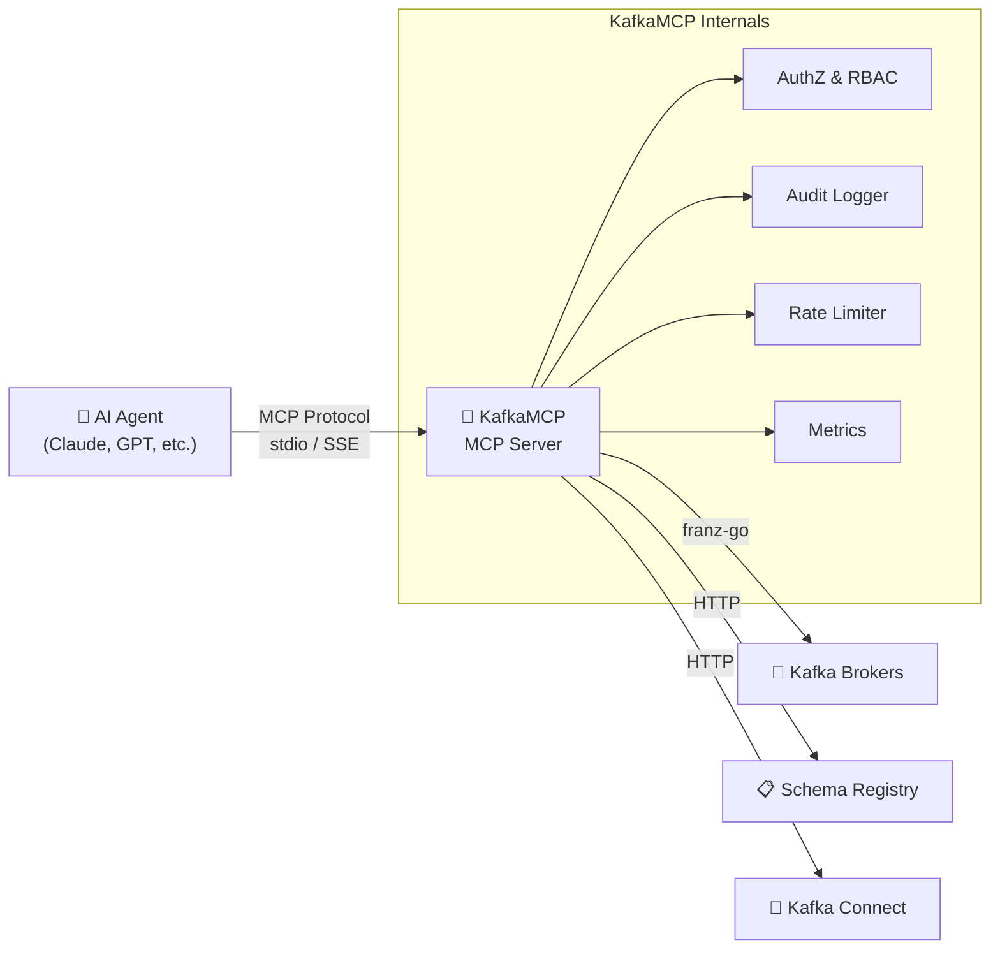

# KafkaMCP

> **Open Source MCP Server That Makes Kafka Topics Fully Readable, Writable, and Discoverable by AI Agents**

[](https://go.dev)
[](https://github.com/kafkamcp/kafkamcp/actions/workflows/ci.yml)
[](https://codecov.io/gh/kafkamcp/kafkamcp)
[](LICENSE)

KafkaMCP is an MCP (Model Context Protocol) server that transforms Apache Kafka into a first-class, agent-accessible data layer. It exposes Kafka topics, consumer groups, schemas, and cluster metadata as MCP tools and resources — enabling any MCP-compatible AI agent to discover, read from, write to, and reason about Kafka data with zero custom integration code.

## Features

- **🔍 Topic Discovery** — List and describe topics, partitions, offsets, and configurations
- **📨 Consume Messages** — Read messages with flexible positioning (earliest, latest, offset, timestamp)
- **📤 Produce Messages** — Publish messages with delivery confirmation
- **📋 Schema Registry** — List and retrieve Avro/Protobuf/JSON schemas with human-readable field summaries
- **👥 Consumer Groups** — Inspect group state, members, partition assignments, and per-partition lag
- **🏗️ Cluster Metadata** — Browse brokers, controller, and cluster topology
- **🔒 Access Control** — YAML-based per-agent policies with default-deny semantics
- **📝 Audit Logging** — Structured JSON audit trail of all agent interactions
- **🔌 Dual Transport** — stdio (local/Claude Desktop) and SSE/HTTP (remote/multi-agent)
- **🏢 Multi-Cluster** — Connect to multiple Kafka clusters with per-cluster configuration

## Quick Start

### 1. Install

**From source:**
```bash
go install github.com/kafkamcp/kafkamcp/cmd/kafkamcp@latest
kafkamcp version
```

**From binary:**
```bash
# Download from GitHub Releases
curl -sSL https://github.com/kafkamcp/kafkamcp/releases/latest/download/kafkamcp_$(uname -s)_$(uname -m).tar.gz | tar xz
sudo mv kafkamcp /usr/local/bin/
kafkamcp version
```

**Docker:**
```bash
docker run --rm ghcr.io/kafkamcp/kafkamcp:latest version
docker run --rm -v $(pwd)/kafkamcp.yaml:/etc/kafkamcp/kafkamcp.yaml \
  ghcr.io/kafkamcp/kafkamcp:latest --config /etc/kafkamcp/kafkamcp.yaml
```

### 2. Configure

Create `kafkamcp.yaml`:

```yaml
server:
  transport: stdio        # stdio | sse | streamable-http
  log_level: info

clusters:
  - name: local
    bootstrap_servers: "localhost:9092"
    security_protocol: PLAINTEXT
    default: true

# Optional: Schema Registry
#   schema_registry:
#     url: "http://localhost:8081"

# Optional: Access Control
# policies:
#   default_deny: true
#   agents:
#     - id: "my-agent"
#       topics:
#         - pattern: "*"
#           permissions: [read, write]
#       consumer_groups:
#         permissions: [describe]
#       schemas:
#         permissions: [read]

audit:
  enabled: true
  max_entries: 10000
```

### 3. Connect to Claude Desktop

Add to your `claude_desktop_config.json`:

```json
{
  "mcpServers": {
    "kafkamcp": {
      "command": "kafkamcp",
      "args": ["--config", "/path/to/kafkamcp.yaml"]
    }
  }
}
```

### 4. Use

Once connected, your AI agent can:

```
"List all Kafka topics in my cluster"
```
> **Example response:** Found 12 topics: `orders.created` (6 partitions), `payments.completed` (3 partitions), `users.updated` (3 partitions), ...

```
"Show me the last 10 messages from the orders.created topic"
```
> **Example response:** 10 messages from `orders.created` (partition 2, offsets 4521–4530):
> ```json
> {"order_id": "ord-9842", "customer": "acme-corp", "amount": 149.99, "status": "created"}
> {"order_id": "ord-9843", "customer": "globex", "amount": 89.50, "status": "created"}
> ...
> ```

```
"Describe the consumer group order-processor and show me the lag"
```
> **Example response:** Consumer group `order-processor` — State: **Stable**, Members: 3, Total lag: **142 messages**
> | Topic | Partition | Current Offset | End Offset | Lag |
> |-------|-----------|---------------|------------|-----|
> | orders.created | 0 | 4510 | 4532 | 22 |
> | orders.created | 1 | 4488 | 4529 | 41 |

```
"What schema does the payments.completed topic use?"
```
> **Example response:** Subject `payments.completed-value` (Avro, version 3, BACKWARD compatible):
> Fields: `payment_id` (string), `order_id` (string), `amount` (double), `currency` (string), `processed_at` (long/timestamp-millis)

```
"Publish a test message to the test-events topic"
```
> **Example response:** ✅ Message delivered to `test-events` partition 0 at offset 847 (timestamp: 2025-01-15T10:32:01Z)

## MCP Tools

### P0 — Core Tools
| Tool | Description |
|------|-------------|
| `kafka_list_topics` | List all topics with metadata |
| `kafka_describe_topic` | Get detailed topic metadata |
| `kafka_consume` | Read messages (earliest/latest/offset/timestamp) |
| `kafka_produce` | Publish messages with delivery confirmation |
| `kafka_list_schemas` | List Schema Registry subjects |
| `kafka_get_schema` | Get full schema definition |
| `kafka_describe_consumer_group` | Get consumer group state and lag |
| `kafka_list_consumer_groups` | List all consumer groups |

### P1 — Advanced Tools
| Tool | Description |
|------|-------------|
| `kafka_subscribe` | Subscribe with consumer group semantics (batch polling) |
| `kafka_create_topic` | Create a topic with partitions, replication, configs |
| `kafka_alter_topic` | Modify topic configuration |
| `kafka_delete_topic` | Delete a topic |
| `kafka_search` | Search messages by key, header, value, time range |
| `kafka_reset_offsets` | Reset consumer group offsets (with dry-run) |
| `kafka_check_schema_compatibility` | Validate schema against compatibility policy |
| `kafka_analyze_dlq` | Analyze dead-letter queue: categorize errors, samples |

### P2 — Stream Processing & Intelligence
| Tool | Description |
|------|-------------|
| `kafka_aggregate` | Windowed aggregation (count/sum/avg/min/max) on a field |
| `kafka_join` | Time-windowed join across two topics on a key field |
| `kafka_query` | Natural language query translated to topic + filter |
| `kafka_suggest_schema_evolution` | Schema change advisor with compatible strategies |
| `kafka_list_connectors` | List Kafka Connect connectors with status |
| `kafka_describe_connector` | Full connector config, tasks, and errors |

### P3 — Event-Driven & Remediation
| Tool | Description |
|------|-------------|
| `kafka_watch` | Register event-driven watch subscriptions on topic patterns |
| `kafka_remediate_dlq` | Auto-remediate DLQ messages: retry, route, or suggest fixes |
| `kafka_schema_diff` | Field-by-field diff between two schema versions |
| `kafka_stream` | Manage streaming consumer sessions for real-time delivery |
| `kafka_agent_registry` | Multi-agent collaboration: register, claim partitions, handoff |

### Advanced — Connector Management & Intelligence
| Tool | Description |
|------|-------------|
| `kafka_create_connector` | Create a new Kafka Connect connector |
| `kafka_update_connector` | Update an existing connector configuration |
| `kafka_delete_connector` | Delete a Kafka Connect connector |
| `kafka_restart_connector` | Restart a connector or specific failed tasks |
| `kafka_connector_health` | Health score and diagnostics for a connector |
| `kafka_time_travel` | Point-in-time topic queries: snapshot or diff state |
| `kafka_recommend` | Intelligent topic optimization recommendations |
| `kafka_trace_message` | End-to-end message tracing via correlation IDs |
| `kafka_list_acls` | List Kafka ACLs with security analysis |
| `kafka_config_drift` | Detect configuration drift across clusters |
| `kafka_playground` | Sandboxed environment for safe Kafka experimentation |

### Feature — AI & Analytics
| Tool | Description |
|------|-------------|
| `kafka_anomalies` | AI-detected anomalies in lag, throughput, and error rates |
| `kafka_anomaly_ingest` | Manually ingest data points for anomaly detection |
| `kafka_nl_query` | Query Kafka with plain English (NL → pipeline) |
| `kafka_cost_analyze` | Analyze storage and compute costs for a topic |
| `kafka_cost_waste` | Detect cost waste: idle topics, over-replication, etc. |
| `kafka_cost_whatif` | Simulate config changes and see cost impact |
| `kafka_workflows` | Pre-built workflow templates for common operations |
| `kafka_gitops_diff` | Compare declarative YAML config against live cluster state |
| `kafka_knowledge_graph` | Query topic relationships and schema dependencies |
| `kafka_platform_info` | Get info about configured Kafka-compatible platforms |
| `kafka_validate_contract` | Validate messages against data contracts |
| `kafka_diagnose_lag` | Deep diagnostic analysis of consumer group lag |
| `kafka_migration_plan` | Plan and validate Kafka migrations between clusters |
| `kafka_trace_lineage` | Track data lineage and PII/compliance annotations |
| `kafka_group_health` | Consumer group health scoring with auto-remediation hints |
| `kafka_persona` | Declarative agent personas (SRE, data-engineer, etc.) |
| `kafka_forecast` | ML-based capacity forecasting (throughput, storage, lag) |

> **Note:** Schema tools (`kafka_list_schemas`, `kafka_get_schema`, `kafka_check_schema_compatibility`, `kafka_schema_diff`) require `schema_registry.url` in cluster config.
> Kafka Connect tools require `connect_url` in cluster config.

## MCP Resources

| Resource URI | Description |
|-------------|-------------|
| `kafka://cluster/metadata` | Cluster brokers, controller, topic/partition counts |
| `kafka://clusters` | All configured clusters for multi-cluster discovery |
| `kafka://topics` | Topic catalog with partition counts |
| `kafka://topics/{name}` | Individual topic detail |
| `kafka://schemas` | Schema Registry subject catalog |
| `kafka://schemas/{subject}` | Individual schema definition |
| `kafka://groups` | Consumer group catalog with state and lag |
| `kafka://groups/{id}` | Individual consumer group detail |
| `kafka://audit/log` | Agent audit trail (recent 1000 entries) |
| `kafka://topic_graph` | Producer → topic → consumer group topology graph |

## Security & Access Control

- **Per-agent authorization** — YAML policy engine with default-deny, topic glob patterns
- **Rate limiting** — Token bucket per agent, configurable via policy
- **Agent ID extraction** — From `X-Agent-ID` or `X-Client-ID` headers
- **TLS 1.3 minimum** — All TLS connections (Kafka broker, Connect API, HTTPS) enforce TLS 1.3 as the minimum version
- **TLS support** — HTTPS for SSE/HTTP transports via `tls_cert`/`tls_key` config
- **Audit logging** — Structured JSON audit trail (file + ring buffer)
- **Auth-filtered list results** — Agents only see resources they're authorized to access

## Observability

- **Prometheus metrics** at `/metrics` (port+1, bound to `127.0.0.1`) — tool call counts, latencies, message throughput, auth denials, rate limit denials
- **Health check** at `/healthz`
- **Structured JSON logging** via `slog`
- **OpenTelemetry tracing** — optional OTLP export for distributed trace analysis (see [Telemetry config](#telemetry-opentelemetry))

## SDKs & Editor Integrations

| SDK / Integration | Path | Description |
|-------------------|------|-------------|
| **Go SDK** | [`sdk/go/`](sdk/go/) | Programmatic Go client for KafkaMCP — list topics, consume, produce, search, watch |
| **Python LangChain** | [`sdk/python/kafkamcp_langchain/`](sdk/python/kafkamcp_langchain/) | LangChain toolkit — use Kafka tools in any LangChain agent |
| **Python CrewAI** | [`sdk/python/kafkamcp_crewai/`](sdk/python/kafkamcp_crewai/) | CrewAI tools — build Kafka-aware multi-agent crews |
| **VS Code Extension** | [`sdk/vscode/`](sdk/vscode/) | Topic explorer, schema browser, NL query, and workflow templates inside VS Code |
| **Cursor Integration** | [`sdk/cursor/`](sdk/cursor/) | Native MCP support — configure `.cursor/mcp.json` and use all tools directly |
| **IntelliJ Plugin** | [`sdk/intellij/`](sdk/intellij/) | IntelliJ/JetBrains IDE integration |

**Go SDK quick example:**
```go
import "github.com/kafkamcp/kafkamcp/sdk/go/kafkamcpsdk"

client := kafkamcpsdk.New(transport, kafkamcpsdk.WithAgentID("my-agent"))
topics, _ := client.ListTopics(ctx, "orders.*")
```

**Python LangChain quick example:**
```bash
pip install kafkamcp-langchain
```
```python
from kafkamcp_langchain import KafkaMCPToolkit
tools = KafkaMCPToolkit(mcp_client=session)
```

**Python CrewAI quick example:**
```bash
pip install kafkamcp-crewai
```
```python
from kafkamcp_crewai import create_kafka_tools
tools = create_kafka_tools(mcp_client=session)
```

## Architecture

```
┌──────────────────────────────────────────────────────────┐
│                     KafkaMCP                              │
│                                                          │
│  ┌─────────────┐  ┌─────────────┐  ┌─────────────┐      │
│  │ AI Agent A  │  │ AI Agent B  │  │ AI Agent C  │      │
│  └──────┬──────┘  └──────┬──────┘  └──────┬──────┘      │
│         │ stdio          │ SSE            │ SSE          │
│         ▼                ▼                ▼              │
│  ┌──────────────────────────────────────────────┐        │
│  │              MCP Server Core                  │        │
│  │  Tools │ Resources │ AuthZ │ Audit │ Rate Lim │        │
│  └──────────────────────┬───────────────────────┘        │
│                         │                                │
│  ┌──────────────────────▼───────────────────────┐        │
│  │         Kafka Client (franz-go)               │        │
│  │  Admin │ Consumer │ Producer │ Schema Client  │        │
│  └──────────────────────┬───────────────────────┘        │
│                         │                                │
│         ┌───────────────┼───────────────┐                │
│         ▼               ▼               ▼                │
│  ┌──────────┐   ┌──────────────┐  ┌──────────┐          │
│  │  Kafka   │   │   Schema     │  │  Kafka   │          │
│  │  Brokers │   │   Registry   │  │  Admin   │          │
│  └──────────┘   └──────────────┘  └──────────┘          │
└──────────────────────────────────────────────────────────┘
```

### Component Flow



## Configuration Reference

### Server
| Field | Type | Default | Description |
|-------|------|---------|-------------|
| `transport` | string | `stdio` | MCP transport: `stdio`, `sse`, `streamable-http` |
| `host` | string | `0.0.0.0` | Bind host for SSE/HTTP |
| `port` | int | `3100` | Bind port for SSE/HTTP |
| `log_level` | string | `info` | Log level: `debug`, `info`, `warn`, `error` |
| `max_message_size` | int | `1048576` | Max MCP message size in bytes (1 MB default) |
| `tls_cert` | string | — | Path to TLS certificate for HTTPS |
| `tls_key` | string | — | Path to TLS private key for HTTPS |

### Clusters
| Field | Type | Required | Description |
|-------|------|----------|-------------|
| `name` | string | Yes | Cluster name |
| `bootstrap_servers` | string | Yes | Kafka broker addresses |
| `security_protocol` | string | No | `PLAINTEXT`, `SASL_PLAINTEXT`, `SASL_SSL`, `SSL` |
| `sasl_mechanism` | string | No | `PLAIN`, `SCRAM-SHA-256`, `SCRAM-SHA-512` |
| `sasl_username` | string | No | SASL username (supports `${ENV_VAR}`) |
| `sasl_password` | string | No | SASL password (supports `${ENV_VAR}`) |
| `ssl_ca_location` | string | No | Path to CA certificate bundle for SSL/TLS |
| `schema_registry.url` | string | No | Schema Registry URL |
| `schema_registry.auth.username` | string | No | Schema Registry basic-auth username |
| `schema_registry.auth.password` | string | No | Schema Registry basic-auth password |
| `connect_url` | string | No | Kafka Connect REST API base URL |
| `connect_tls` | object | No | TLS settings for the Kafka Connect REST API |
| `connect_tls.ca_file` | string | No | Path to CA certificate for verifying the Connect REST API server |
| `connect_tls.insecure_skip_verify` | bool | No | Skip TLS certificate verification (default `false`) |
| `default` | bool | No | Mark as default cluster |

### Policies
| Field | Type | Default | Description |
|-------|------|---------|-------------|
| `default_deny` | bool | `false` | Deny all access by default |
| `agents[].id` | string | — | Agent identifier |
| `agents[].role` | string | — | Agent role (e.g., `admin`, `viewer`) |
| `agents[].topics[].pattern` | string | — | Glob pattern (e.g., `orders.*`) |
| `agents[].topics[].permissions` | []string | — | `read`, `write`, `create`, `delete` |
| `agents[].consumer_groups.permissions` | []string | — | Consumer group permissions |
| `agents[].schemas.permissions` | []string | — | Schema Registry permissions |
| `agents[].rate_limit.requests_per_minute` | int | — | Max requests per minute for this agent |

### Schema Cache
| Field | Type | Default | Description |
|-------|------|---------|-------------|
| `schema_cache.max_entries` | int | `10000` | Maximum number of cached schemas |
| `schema_cache.ttl_seconds` | int | `300` | Cache entry time-to-live in seconds |

### Audit
| Field | Type | Default | Description |
|-------|------|---------|-------------|
| `audit.enabled` | bool | `false` | Enable audit logging |
| `audit.max_entries` | int | `10000` | Max in-memory audit entries |
| `audit.log_file` | string | — | Path to audit log file |

### Telemetry (OpenTelemetry)
| Field | Type | Default | Description |
|-------|------|---------|-------------|
| `telemetry.enabled` | bool | `false` | Enable OpenTelemetry tracing |
| `telemetry.endpoint` | string | — | OTLP collector endpoint (e.g., `localhost:4317`) |
| `telemetry.insecure` | bool | `false` | Use insecure (non-TLS) connection to collector |
| `telemetry.service_name` | string | `kafkamcp` | Service name reported in traces |
| `telemetry.sample_rate` | float | `1.0` | Trace sampling rate (0.0–1.0) |

### Environment Variables

Config values support `${VAR}` and `${VAR:-default}` syntax:

```yaml
sasl_username: "${KAFKA_USERNAME}"
sasl_password: "${KAFKA_PASSWORD:-changeme}"
```

## Development

### Prerequisites

- Go 1.25+
- Docker (for integration tests)
- A Kafka cluster (local or remote)

### Setup

Install all dev dependencies in one command:

```bash
make setup
```

### Build

```bash
make build
```

### Test

```bash
make test
```

### Lint

```bash
make lint
```

### Run All Checks

```bash
make validate
```

### Validate Config

```bash
./bin/kafkamcp validate --config kafkamcp.yaml
```

### See All Targets

```bash
make help
```

## Project Structure

```
kafkamcp/
├── cmd/kafkamcp/          # CLI entrypoint
│   └── main.go
├── internal/
│   ├── anomaly/           # AI-powered anomaly detection (z-score, IQR)
│   ├── audit/             # Structured JSON audit logger
│   ├── auth/              # Policy engine (per-agent access control)
│   ├── cloud/             # Cloud provider integrations
│   ├── config/            # YAML config loader with env var expansion
│   ├── contracts/         # Schema-aware data contracts
│   ├── cost/              # Kafka cost analysis and waste detection
│   ├── dashboard/         # Dashboard data aggregation
│   ├── dlq/               # Dead-letter queue remediation
│   ├── evolution/         # Schema evolution advisor
│   ├── flowdebug/         # Message flow debugging
│   ├── forecast/          # ML-based capacity forecasting
│   ├── gitops/            # GitOps configuration management
│   ├── graph/             # Embedded knowledge graph
│   ├── kafka/             # Kafka client manager (admin, consume, produce)
│   ├── lagdiag/           # Consumer lag root cause analysis
│   ├── lineage/           # Topic data lineage tracking
│   ├── masking/           # PII redaction and data masking engine
│   ├── match/             # Topic pattern matching utilities
│   ├── metrics/           # Prometheus metrics collection
│   ├── migration/         # Kafka migration planning assistant
│   ├── nlquery/           # Natural language query engine
│   ├── persona/           # Declarative agent personas
│   ├── platform/          # Multi-platform abstraction (Kafka, Redpanda, MSK)
│   ├── plugin/            # Plugin/extension registry
│   ├── ratelimit/         # Per-agent rate limiting
│   ├── replication/       # Cross-cluster replication monitoring
│   ├── schema/            # Schema Registry client with LRU cache
│   ├── selfheal/          # Self-healing consumer group monitor
│   ├── server/            # MCP server, tool/resource handlers
│   ├── telemetry/         # OpenTelemetry tracing provider
│   ├── tenant/            # Multi-tenant isolation
│   ├── watch/             # Event-driven watch subscriptions
│   └── workflow/          # Agent workflow templates
├── sdk/
│   ├── go/                # Go client SDK
│   ├── python/            # Python SDKs (LangChain, CrewAI)
│   ├── vscode/            # VS Code extension
│   ├── cursor/            # Cursor editor integration
│   └── intellij/          # IntelliJ plugin
├── deploy/
│   └── helm/              # Helm chart for Kubernetes
├── examples/              # Example configurations
├── .github/workflows/     # CI/CD
├── Dockerfile
├── kafkamcp.yaml          # Example configuration
├── go.mod
└── go.sum
```

## License

Apache License 2.0 — see [LICENSE](LICENSE).

## Troubleshooting

### Kafka connection refused

```
error: creating kafka manager: dial tcp 127.0.0.1:9092: connect: connection refused
```

Ensure Kafka is running and `bootstrap_servers` in your config points to the correct address. If using Docker: `docker compose -f examples/docker-compose.yaml up -d`.

### Schema Registry unavailable

Schema tools (`kafka_list_schemas`, `kafka_get_schema`) require `schema_registry.url` in your cluster config. If the registry isn't running, these tools will return errors but other tools continue to work.

### SASL authentication failures

```
error: SASL handshake failed
```

Verify `sasl_mechanism`, `sasl_username`, and `sasl_password` match your broker config. Use `${ENV_VAR}` syntax to avoid hardcoding secrets. Supported mechanisms: `PLAIN`, `SCRAM-SHA-256`, `SCRAM-SHA-512`.

### Port already in use

```
error: listen tcp :3100: bind: address already in use
```

Another process is using the configured port. Either stop that process or change `server.port` in your config. The metrics endpoint runs on `127.0.0.1:port+1` (default `127.0.0.1:3101`); in container or Kubernetes deployments you may need to expose it separately since it only binds to localhost.

### Permission denied

If using access control (`default_deny: true`), ensure the connecting agent's ID is listed in your policies and has the required permissions for the topics/groups it needs to access. Check audit logs for denied requests.

### More Help

For additional troubleshooting guides, see the [full troubleshooting documentation](https://kafkamcp.dev/docs/troubleshooting).

## Documentation & Community

- 📖 **Website & Docs** — [kafkamcp.dev](https://kafkamcp.dev)
- 💬 **Discord** — [discord.gg/kafkamcp](https://discord.gg/kafkamcp)

## Contributing

Contributions are welcome! Please see [CONTRIBUTING.md](CONTRIBUTING.md) for detailed guidelines.

1. Fork the repository
2. Create a feature branch (`git checkout -b feature/amazing-feature`)
3. Commit your changes (`git commit -m 'Add amazing feature'`)
4. Push to the branch (`git push origin feature/amazing-feature`)
5. Open a Pull Request

## Security

To report a vulnerability, please see [SECURITY.md](SECURITY.md).

## Roadmap

- [x] **v0.1**: Core P0 tools (list, describe, consume, produce, schemas, groups)
- [x] **v0.2**: Auth enforcement, rate limiting, Prometheus metrics
- [x] **v0.3**: P1 tools (subscribe, topic CRUD, search, offset reset, DLQ analysis, schema compat)
- [x] **v0.4**: P2 tools (aggregate, join, NL query, schema evolution, Kafka Connect, topic graph)
- [x] **v0.4**: All MCP resources (10 static + 3 templates)
- [ ] **v1.0**: Cloud managed service, enterprise features (SSO, data masking)

See the [PRD](docs/internal/PRD.md) for the complete roadmap.
