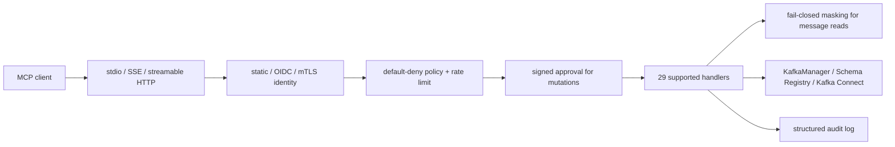

# KafkaMCP Architecture

KafkaMCP is a focused MCP gateway for real Apache Kafka operations. The runtime
surface is deliberately small: **29 tools** across `core-read`, `ops-write`,
and `governance`, plus **9 resources**. No simulated, placeholder, operator, or
control-plane feature is compiled into the product.

## Start here

Read these files in order:

1. `cmd/kafkamcp/main.go` - CLI and config loading.
2. `internal/app/app.go` - runtime lifecycle, transports, probes, and shutdown.
3. `internal/config/config.go` - validation, defaults, and environment expansion.
4. `internal/server/server.go` - server construction and shared dependencies.
5. `internal/server/register_tools.go` - the complete supported tool registration.
6. `internal/kafka/interface.go` - broker operations available to handlers.

## Request flow



All tool handlers enter through `withToolAuth`. Mutating handlers also pass the
common approval and idempotency middleware. `kafka_consume`, `kafka_search`,
and `kafka_analyze_dlq` apply masking before returning message payloads.

## Runtime components

`Server` embeds three small subsystem groups:

| Group | Runtime dependencies |
| --- | --- |
| `Governance` | policy engine, verified identity, audit logger, rate limiter, masking |
| `Analytics` | consumer-lag analyzer used by `kafka_diagnose_lag` |
| `Platform` | cluster discovery, OPA policy evaluation, ACL reconciliation, OTel provider |

There is no generic feature registry or experimental subsystem. A component is
initialized only when a supported tool or resource uses it.

## Supported package layout

```text
internal/
├── aclmgmt/       # stateless ACL diff/audit/reconcile calculations
├── app/           # production runtime and HTTP lifecycle
├── approval/      # signed, scoped, single-use approval grants
├── audit/         # audit ring buffer and JSONL export
├── auth/          # policy and identity providers
├── config/        # YAML schema, validation, defaults
├── doctor/        # read-only deployment diagnostics
├── engine/        # in-memory / SQLite state backend with CAS
├── idempotency/   # mutation reservation and replay receipts
├── kafka/         # supported broker, ACL, and Connect operations
├── lagdiag/       # lag root-cause analysis
├── masking/       # keyed masking and payload traversal
├── match/         # glob matching
├── metrics/       # Prometheus metrics
├── onboarding/    # real cluster discovery
├── opa/           # policy evaluate/simulate engine
├── randid/        # cryptographic identifiers
├── ratelimit/     # persistent token buckets
├── readiness/     # objective release gates
├── schema/        # Schema Registry client and cache
├── server/        # MCP tools/resources and middleware
├── telemetry/     # OpenTelemetry provider
└── tooleval/      # supported-surface routing evaluation
```

## Tool registration

`registerTools()` calls exactly ten registration functions. Those functions
define only the 29 allow-listed tools. `ToolPackFilter` selects the configured
subset; any name outside the allow-lists is rejected.

Tool stability is derived from membership:

- `core-read` -> stable
- `ops-write` / `governance` -> beta

Generated references are built from the same allow-lists, so runtime discovery,
tests, and documentation share one source of truth.

## Resources

`register_resources.go` registers six static resources and three templates:

- `kafka://cluster/metadata`
- `kafka://clusters`
- `kafka://topics`
- `kafka://schemas`
- `kafka://groups`
- `kafka://audit/log`
- `kafka://topics/{name}`
- `kafka://schemas/{subject}`
- `kafka://groups/{id}`

## Persistence and concurrency

The engine backend provides in-memory and SQLite implementations. Atomic
compare-and-swap protects approval and idempotency transitions across separate
managers. SQLite remains single-writer: guarded packs or SQLite deploy with one
active replica.

## Shutdown

The app drains the MCP HTTP server and metrics/probe server first. Then
`Server.Close()` shuts down telemetry, audit, identity, and persistence before
closing `KafkaManager` last.

## Adding a tool

There is no staging pack for incomplete work.

1. Implement real domain/provider behavior.
2. Add handler and registration files.
3. Route through auth, audit, masking, approval, and idempotency as applicable.
4. Add unit tests and a real integration/provider contract.
5. Add the tool to exactly one supported pack.
6. Run `make generate` and all release gates.

A handler returning canned, simulated, or metadata-only success is not
admissible.
