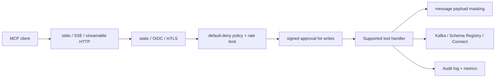

# Architecture

KafkaMCP is a focused MCP gateway exposing **29 real tools** and **9 real
resources**. The runtime does not include simulated tools, decorative
controllers, or placeholder integrations.

## Supported surface

| Pack | Purpose |
| --- | --- |
| `core-read` | 15 stable topic, message, schema, group, lag, DLQ, health, metrics, and discovery tools |
| `ops-write` | Approval-gated topic, message, connector, offset, and ACL mutations |
| `governance` | Approval lifecycle, policy evaluation/simulation, and ACL reconciliation |

Tool registration, runtime discovery, generated docs, and tests all read from
the same allow-lists in `internal/server/tool_packs.go`.

## Request lifecycle

1. The transport receives an MCP request.
2. Static, OIDC, or mTLS identity is verified for network transports.
3. Default-deny authorization and rate limits are evaluated.
4. Mutations consume a matching signed approval; retry-safe mutations reserve
   an idempotency key.
5. The handler calls `KafkaManager`, Schema Registry, or Kafka Connect.
6. Message-returning reads apply masking fail-closed.
7. The result and verified identity are audited.

## Runtime packages

The production binary keeps a small set of packages:

- `app`, `config`, `server`, `kafka`, `schema`
- `auth`, `approval`, `audit`, `ratelimit`, `masking`, `metrics`, `telemetry`
- `engine`, `idempotency`
- `lagdiag`, `onboarding`, `opa`, `aclmgmt`
- `doctor`, `readiness`, `tooleval`, `match`, `randid`

Only dependencies used by the supported surface are initialized.

## Resources

The nine supported resource URIs cover cluster metadata/listing, topics,
schemas, consumer groups, and the audit log. See the
[resource reference](./api-reference/resources.md).

## Persistence and HA

Approval and idempotency state can use SQLite with atomic compare-and-swap.
SQLite and guarded packs require one active replica. Read-only in-memory
deployments may scale horizontally.

## Shutdown

KafkaMCP drains the main HTTP transport and metrics/probe listener, then closes
telemetry, audit, identity, persistence, and finally Kafka connections.

## Extension rule

Incomplete work stays outside runtime packs. A new tool must have real provider
behavior, authorization/audit integration, unit tests, and a real integration
or provider contract before it can be registered.
