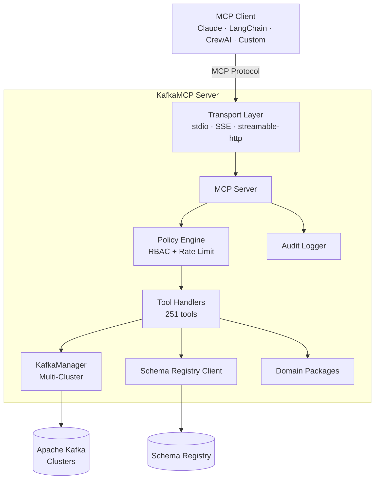
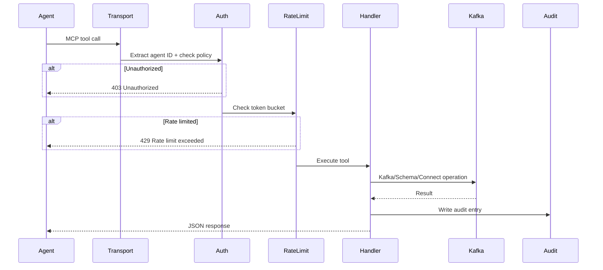

# Architecture

KafkaMCP is a purpose-built bridge between AI agents and Apache Kafka. This page explains the system design, request lifecycle, and how the major components fit together.

## Overview



## Components

### Transport Layer

KafkaMCP supports three MCP transports:

| Transport | Use Case | Protocol |
|-----------|----------|----------|
| **stdio** | Local agents (Claude Desktop, Cursor) | stdin/stdout |
| **SSE** | Remote agents, multi-agent setups | HTTP + Server-Sent Events |
| **streamable-http** | Modern HTTP streaming | HTTP with streaming response |

The transport is configured in `kafkamcp.yaml` under `server.transport`. For local development, `stdio` is the default. For shared deployments, use `sse` or `streamable-http`.

### MCP Server

The MCP server registers all 251 tools and 18 resources, then routes incoming requests through the middleware chain:

1. **Agent identity extraction** — resolves `X-Agent-ID`, `X-Client-ID`, or `anonymous`
2. **Authorization** — policy engine checks glob-matched topic/group/schema permissions
3. **Rate limiting** — token bucket enforces per-agent `requests_per_minute`
4. **Handler execution** — the appropriate tool handler runs the Kafka operation
5. **Audit logging** — records agent ID, tool name, parameters, latency, and result status
6. **Response** — JSON result returned to the agent

### KafkaManager

All Kafka communication flows through the `KafkaManager` in `internal/kafka/`. It manages:

- **Multi-cluster connections** — one `franz-go` client per configured cluster
- **Admin operations** — topic CRUD, consumer group management, ACL queries
- **Consumer operations** — offset-based reads, subscriptions, search/filter
- **Producer operations** — message publishing with delivery confirmation
- **Kafka Connect** — connector lifecycle via the Connect REST API

### Schema Registry Client

The schema client in `internal/schema/` provides:

- Subject and version listing
- Full schema retrieval (Avro, Protobuf, JSON Schema)
- Compatibility checking
- Human-readable field summaries
- LRU cache with configurable TTL and max entries

### Policy Engine

The authorization system in `internal/auth/` evaluates YAML-defined policies:

- **Glob pattern matching** on topic names (`orders.*`, `*.dlq`)
- **Permission types** — `read`, `write`, `create`, `delete`, `admin` for topics; `describe`, `reset` for consumer groups; `read` for schemas
- **Default-deny mode** — blocks all access unless explicitly allowed
- **Auth-filtered results** — list operations only return resources the agent can access

### Audit Logger

Every tool call and resource read is recorded with:

- Timestamp, agent ID, tool/resource name
- Input parameters and cluster name
- Result status, latency, message count
- Error details on failure

Entries are kept in an in-memory ring buffer and optionally written to a JSONL file.

## Request Lifecycle



## Directory Structure

```text
kafkamcp/
├── cmd/kafkamcp/          # CLI entrypoint (main.go)
├── internal/
│   ├── config/            # YAML config loading & validation
│   ├── kafka/             # Kafka client abstraction (KafkaManager)
│   ├── schema/            # Schema Registry client + LRU cache
│   ├── server/            # MCP server: registration, handlers, resources
│   ├── auth/              # YAML policy engine
│   ├── ratelimit/         # Per-agent token bucket limiter
│   ├── audit/             # Structured JSON audit logger
│   ├── metrics/           # Prometheus metric definitions
│   └── <domain>/          # ~90 domain packages for advanced features
├── sdk/                   # Client SDKs (Go, Python, TypeScript)
├── deploy/                # Helm charts, Grafana dashboards
├── examples/              # Docker Compose files, example configs
├── website/               # Docusaurus documentation site
└── kafkamcp.yaml          # Default configuration file
```

## Key Design Decisions

### Single binary, no JVM

KafkaMCP is written in Go and compiles to a single static binary. No JVM, no runtime dependencies. This makes deployment trivial — copy the binary and run it.

### franz-go over confluent-kafka-go

KafkaMCP uses [franz-go](https://github.com/twmb/franz-go) as its Kafka client. Unlike `confluent-kafka-go`, franz-go is pure Go with no CGO dependency, which simplifies cross-compilation and container builds.

### MCP-native, not REST-wrapped

KafkaMCP speaks the MCP protocol directly. It does not wrap a REST API. This means agents get structured tool definitions with typed parameters, not raw HTTP endpoints they need to guess at.

### Policy-driven, not role-based

Instead of mapping agents to fixed roles, KafkaMCP uses glob-pattern policies that match specific topics. This gives fine-grained control: one agent can read `orders.*` but not `payments.*`, while another gets full admin access.

### Audit-first

Every operation is audited before the response is sent. The audit log is not optional infrastructure — it is built into the request lifecycle. This makes compliance and debugging straightforward.

## Performance Characteristics

- **Startup time**: < 1 second (no JVM warm-up)
- **Memory footprint**: ~50-100 MB for typical workloads
- **Concurrency**: Semaphore-bounded expensive operations to protect broker connections
- **Schema cache**: LRU with configurable TTL avoids repeated registry lookups
- **Rate limiting**: O(1) token bucket per agent

## Next Steps

- [**Configuration**](./configuration) — Full YAML reference
- [**Core Concepts**](./core-concepts) — Tools vs resources, auth model, multi-cluster
- [**Deployment**](./deployment/binary) — Binary, Docker, and Kubernetes guides
