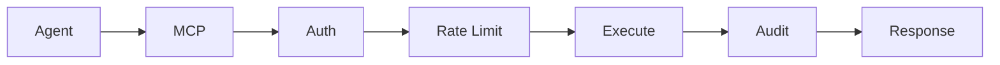

# Core Concepts

KafkaMCP is easiest to understand if you separate **the MCP layer** from **the Kafka layer**.

## MCP basics: tools vs resources

### Tools

Tools are **actions**. An agent calls them when it wants KafkaMCP to do work.

Examples:

- `kafka_list_topics`
- `kafka_consume`
- `kafka_produce`
- `kafka_reset_offsets`

Use a tool when you want KafkaMCP to **query, mutate, or compute**.

### Resources

Resources are **read-only documents** that agents can browse.

Examples:

- `kafka://topics`
- `kafka://topics/{name}`
- `kafka://schemas`
- `kafka://audit/log`

Use a resource when you want KafkaMCP to **publish discoverable JSON state** that an agent can inspect without inventing its own schema.

:::tip
A good rule: if the operation sounds like a verb, it is probably a tool. If it looks like a URI that returns JSON state, it is probably a resource.
:::

## How KafkaMCP bridges Kafka

KafkaMCP sits between an MCP-compatible client and your Kafka infrastructure.

It translates MCP calls into the right Kafka operation:

- topic discovery becomes Kafka admin metadata calls
- message reads become Kafka consumer reads
- message writes become Kafka producer sends
- schema lookups become Schema Registry API calls
- connector inspection becomes Kafka Connect REST calls

That gives agents a standard interface without forcing you to expose raw Kafka clients inside agent code.

## Request flow



### What happens on every call

1. The agent sends a tool call or resource read over MCP.
2. KafkaMCP extracts the agent identity.
3. The policy engine checks whether the agent can access the requested topic, group, or schema.
4. The rate limiter checks the per-agent budget.
5. KafkaMCP executes the Kafka, Schema Registry, or Connect request.
6. KafkaMCP writes an audit record with status, latency, cluster, and message count.
7. The result is returned to the agent as JSON.

## The auth model

KafkaMCP uses a YAML policy engine defined under `policies` in `kafkamcp.yaml`.

### Agent identity

KafkaMCP resolves the agent ID in this order:

1. `X-Agent-ID`
2. `X-Client-ID`
3. `anonymous`

That ID is what the policy engine and rate limiter evaluate.

### Default-deny behavior

If `policies.default_deny` is `true`, KafkaMCP blocks access unless the current agent has an explicit matching rule.

That affects:

- topic reads and writes
- topic administration
- consumer group inspection and resets
- schema access

It also filters list results. For example, `kafka_list_topics` only returns topics the agent can read when default-deny is enabled.

:::warning
If you enable `default_deny` and forget to define an agent policy, KafkaMCP will reject that agent's requests as unauthorized.
:::

### Policy matching

Topic rules use glob-style patterns such as:

- `orders.*`
- `*.dlq`
- `payments-*`
- `*`

Permissions are evaluated per resource type:

- **topics**: `read`, `write`, `create`, `delete`, `admin`
- **consumer groups**: `describe`, `reset`
- **schemas**: `read`

## Rate limiting

Rate limits are configured per agent with `requests_per_minute`.

KafkaMCP applies the limiter **before** executing the Kafka operation. If the agent exceeds its budget, the server returns:

```text
Rate limit exceeded. Please retry later.
```

Use rate limits to protect clusters from:

- runaway autonomous loops
- overly aggressive polling
- high-cost search or aggregation bursts
- accidental fan-out across many topics

## Audit logging

Every tool call and resource read can be recorded in the audit log.

An audit entry includes:

- timestamp
- agent ID
- tool or resource name
- input parameters
- cluster name
- result status
- latency in milliseconds
- message count
- error text when a call fails

KafkaMCP keeps recent entries in memory and can also append them to a JSONL file.

:::info
The `kafka://audit/log` resource exposes the recent in-memory audit trail so agents can inspect what happened without direct file access.
:::

## Multi-cluster

KafkaMCP can connect to more than one Kafka cluster at the same time.

Each cluster is defined under `clusters:` with a unique `name`. One cluster is marked as `default: true`, and KafkaMCP falls back to the first cluster if no default is marked.

Most tools accept an optional `cluster` parameter:

```json
{
  "name": "kafka_consume",
  "arguments": {
    "cluster": "production",
    "topic": "orders.created",
    "limit": 10
  }
}
```

If `cluster` is omitted, KafkaMCP uses the default cluster.

For discovery, agents can read `kafka://clusters` to see which clusters are configured.

## Why this model works

KafkaMCP keeps the surface area simple:

- MCP gives agents a portable contract
- Kafka stays behind a purpose-built server
- policies stay centralized in YAML
- rate limits and audit logging stay consistent across every tool
- multi-cluster routing is explicit instead of hidden in prompts

That is what makes Kafka usable by agents without turning every integration into custom glue code.
