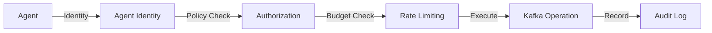

# Security

KafkaMCP is designed to be the secure boundary between AI agents and your Kafka infrastructure. This page covers the security model, threat mitigations, and best practices.

## Security Model

KafkaMCP implements defense-in-depth with multiple layers:



### Agent Identity

KafkaMCP resolves agent identity from HTTP headers in this order:

1. `X-Agent-ID` header
2. `X-Client-ID` header
3. Falls back to `anonymous`

For `stdio` transport (local agents like Claude Desktop), the agent typically runs as `anonymous` unless the MCP client sends identity headers.

### Authorization (Policy Engine)

The YAML policy engine provides fine-grained access control:

- **Default-deny mode** — when `policies.default_deny: true`, all access is blocked unless an explicit rule allows it
- **Glob pattern matching** — topic rules use patterns like `orders.*`, `*.dlq`, `payments-*`
- **Per-resource permissions** — topics (`read`, `write`, `create`, `delete`, `admin`), consumer groups (`describe`, `reset`), schemas (`read`)
- **Auth-filtered results** — list operations only return resources the agent is authorized to see

### Rate Limiting

Per-agent token bucket rate limiting prevents:

- Runaway autonomous agent loops
- Aggressive polling that overloads brokers
- High-cost search or aggregation bursts
- Accidental fan-out across many topics

Configure via `policies.agents[].rate_limit.requests_per_minute`.

### Audit Logging

Every tool call and resource read is recorded with:

- Timestamp, agent ID, tool/resource name
- Input parameters (with sensitive values redacted)
- Cluster name, result status, latency
- Message count and error details

Audit entries are kept in memory and optionally written to a JSONL file for durable storage.

## Transport Security

### TLS

KafkaMCP enforces **TLS 1.3** as the minimum version for all TLS connections:

- Kafka broker connections (`security_protocol: SSL` or `SASL_SSL`)
- Kafka Connect REST API calls
- HTTPS server (when `tls_cert` and `tls_key` are configured)

### SASL Authentication

Supported SASL mechanisms for Kafka broker authentication:

- `PLAIN`
- `SCRAM-SHA-256`
- `SCRAM-SHA-512`

:::warning
KafkaMCP logs a warning when SASL PLAIN is used without TLS. Always use `SASL_SSL` in production.
:::

### Schema Registry Credentials

Schema Registry connections support basic authentication. KafkaMCP warns when credentials are sent over non-HTTPS connections.

## Data Protection

### PII Redaction (Data Masking)

KafkaMCP supports policy-driven field-level masking before messages reach agents:

- **Built-in detectors** — email, SSN, credit card, phone number
- **NER detection** — lightweight named entity recognition for PII
- **Custom regex** — define your own patterns
- **Per-agent rules** — apply different masking policies to different agents
- **JSON path patterns** — target specific fields (`$.user.email`, `**email**`)

```yaml
masking:
  enabled: true
  rules:
    - name: redact-emails
      type: email
      field_path: "**email**"
    - name: custom-api-key
      type: regex
      pattern: "API_KEY_\\w+"
      replace: "[REDACTED_KEY]"
      agents: ["restricted-agent"]
```

### Sensitive Data Redaction

KafkaMCP automatically redacts sensitive information in:

- **Audit logs** — passwords, tokens, and credentials are never logged
- **Connector configs** — Kafka Connect connector configurations have sensitive fields masked
- **Error messages** — stack traces and error details do not leak credentials

## Input Validation

KafkaMCP validates all inputs before executing operations:

| Validation | Purpose |
|------------|---------|
| **Max message size** | Prevents oversized produce payloads (default: 1 MB) |
| **String length limits** | Prevents injection via overly long parameters |
| **Cluster name validation** | Only configured cluster names are accepted |
| **Dangerous config keys** | Blocks modification of critical topic configs (`min.insync.replicas`, etc.) |
| **Consume timeout capping** | Prevents unbounded consumer reads |
| **Window bounds clamping** | Limits aggregate and join window sizes |
| **Join limit clamping** | Caps the number of join results |

## Concurrency Protection

- **Semaphore** — limits concurrent expensive operations (consume, produce, describe) to protect broker connections
- **HTTP response body limit** — 10 MB cap on Kafka Connect REST API responses
- **Cryptographic random IDs** — subscriber group IDs use `crypto/rand` to prevent collisions

## HTTP Security

When running with SSE or streamable-http transport, KafkaMCP applies security headers middleware:

- `X-Content-Type-Options: nosniff`
- `X-Frame-Options: DENY`
- `Strict-Transport-Security` (when TLS is enabled)

The metrics endpoint binds to `127.0.0.1` only, preventing external access to operational metrics.

## Best Practices

### Production Checklist

1. **Enable default-deny** — set `policies.default_deny: true`
2. **Define agent policies** — give each agent only the permissions it needs
3. **Enable audit logging** — set `audit.enabled: true` with a `log_file` for durability
4. **Use TLS everywhere** — configure `security_protocol: SASL_SSL` for Kafka, HTTPS for Schema Registry
5. **Set rate limits** — configure `requests_per_minute` for every agent
6. **Enable data masking** — mask PII fields before they reach agents
7. **Use environment variables** — keep credentials out of config files with `${VAR}` expansion
8. **Review audit logs** — regularly inspect what agents are doing

### Least Privilege Example

```yaml
policies:
  default_deny: true
  agents:
    - id: incident-agent
      topics:
        - pattern: "*.dlq"
          permissions: [read]
        - pattern: "monitoring.*"
          permissions: [read]
      consumer_groups:
        permissions: [describe]
      schemas:
        permissions: [read]
      rate_limit:
        requests_per_minute: 60
```

This agent can only read DLQ and monitoring topics, describe consumer groups, and read schemas — nothing else.

## Reporting Vulnerabilities

If you discover a security vulnerability, please report it responsibly:

1. **Do not** open a public GitHub issue
2. Email the maintainers or use the [GitHub Security Advisories](https://github.com/kafkamcp/kafkamcp/security/advisories) feature
3. Include steps to reproduce and potential impact
4. Allow reasonable time for a fix before public disclosure

See [SECURITY.md](https://github.com/kafkamcp/kafkamcp/blob/main/SECURITY.md) for full details.
