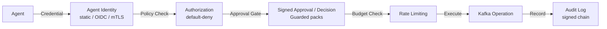

# Security

KafkaMCP is designed to be the secure boundary between AI agents and your Kafka infrastructure. This page covers the security model, threat mitigations, and best practices.

## Security Model

KafkaMCP implements defense-in-depth with multiple layers:



### Agent Identity

KafkaMCP supports four identity providers, selected by `policies.identity.provider`:

| Provider | Credential | Suitable for |
|----------|-----------|--------------|
| `none` (default) | `X-Agent-ID` / `X-Client-ID` header | stdio transport, local dev |
| `static` | `Authorization: Bearer <token>` against an inline token table | Simple multi-agent deployments |
| `oidc` | JWT bearer token verified against an OIDC issuer's JWKS | Enterprise / SSO environments |
| `mtls` | TLS client certificate (SPIFFE URI SAN → URI SAN → Subject CN) | Service-mesh / zero-trust deployments |

**Network transport enforcement:** `sse` and `streamable-http` transports refuse to start without a cryptographic identity provider (`static`, `oidc`, or `mtls`) and `policies.default_deny: true`. The `X-Agent-ID` header fallback is rejected by default for all cryptographic providers — an attacker cannot bypass verification by omitting their credential. Use `server.dangerously_allow_unauthenticated_network: true` only for local development.

Static provider tokens are converted to SHA-256 fingerprints at startup; raw
tokens are not retained, and verification scans all configured fingerprints
with constant-time comparison.

### Authorization (Policy Engine)

The YAML policy engine provides fine-grained access control:

- **Default-deny mode** — when `policies.default_deny: true`, all access is blocked unless an explicit rule allows it
- **Glob pattern matching** — topic rules use patterns like `orders.*`, `*.dlq`, `payments-*`
- **Per-resource permissions** — topics (`read`, `write`, `create`, `delete`, `admin`), consumer groups (`describe`, `reset`), schemas (`read`)
- **Auth-filtered results** — list operations only return resources the agent is authorized to see

### Approval Grants and Decisions (guarded packs)

`ops-write` and `governance` are **rejected on stdio**. The config validator
enforces a complete secure posture at startup:

| Requirement | Value |
|-------------|-------|
| Transport | `sse` or `streamable-http` (not stdio) |
| Identity provider | `static`, `oidc`, or `mtls` |
| Header fallback | disabled (`allow_header_fallback: false`) |
| Authorization | `default_deny: true` |
| Signing key | `KAFKAMCP_APPROVAL_SIGNING_KEY` ≥32 bytes |
| Self-approval | `false` (two-person rule, default) |

Every mutating or destructive action then requires a short-lived, single-use
approval grant before it executes:

1. **Request** — agent calls `kafka_approval` with `action=request`, specifying the target tool, cluster, resource, and arguments. KafkaMCP server-digests the normalized arguments into `args_digest`.
2. **Policy simulation** — call `kafka_governance_decision` with `action=simulate` to preview whether the grant would be authorized, including blast-radius and recovery guidance, without side effects.
3. **Approve** — a different identity (two-person rule; `allow_self_approval: false` by default) calls `kafka_approval` with `action=approve`.
4. **Use** — the original agent uses the approval token when calling the mutating tool. The token is consumed on first use.
5. **Audit** — every transition (request → approve → use / expire / revoke) is signed with `KAFKAMCP_APPROVAL_SIGNING_KEY` and recorded. Use `action=verify` to validate a grant's decision chain and `action=export` to export records.

### Rate Limiting

Per-agent token bucket rate limiting prevents:

- Runaway autonomous agent loops
- Aggressive polling that overloads brokers
- High-cost search or aggregation bursts
- Accidental fan-out across many topics

Configure via `policies.agents[].rate_limit.requests_per_minute`.

### Audit Logging

Every tool call and resource read is recorded with:

- Timestamp, agent ID, tool/resource name
- Input parameters (with sensitive values redacted)
- Cluster name, result status, latency
- Message count and error details

Audit entries are kept in memory and optionally written to a JSONL file for durable storage.

## Transport Security

### TLS

KafkaMCP applies transport-specific TLS minimums:

- The inbound MCP HTTPS server requires **TLS 1.3**.
- Kafka broker connections (`security_protocol: SSL` or `SASL_SSL`) default to
  **TLS 1.2** for provider compatibility and can be raised to TLS 1.3 with
  `tls_min_version`.
- Kafka Connect REST calls follow the same TLS 1.2 default and support an
  explicit TLS 1.3 minimum through `connect_tls.min_version`.
- Schema Registry HTTPS uses Go's secure TLS defaults.

### SASL Authentication

Supported SASL mechanisms for Kafka broker authentication:

- `PLAIN`
- `SCRAM-SHA-256`
- `SCRAM-SHA-512`

:::warning
KafkaMCP logs a warning when SASL PLAIN is used without TLS. Always use `SASL_SSL` in production.
:::

### Schema Registry Credentials

Schema Registry connections support basic authentication. KafkaMCP warns when credentials are sent over non-HTTPS connections.

## Data Protection

### PII Redaction (Data Masking)

KafkaMCP supports policy-driven field-level masking before messages reach agents:

- **Built-in detectors** — email, SSN, credit card, phone number
- **NER detection** — lightweight named entity recognition for PII
- **Custom regex** — define your own patterns
- **Per-agent rules** — apply different masking policies to different agents
- **JSON path patterns** — target specific fields (`$.user.email`, `**email**`)

```yaml
masking:
  enabled: true
  rules:
    - name: redact-emails
      type: email
      field_path: "**email**"
    - name: custom-api-key
      type: regex
      pattern: "API_KEY_\\w+"
      replace: "[REDACTED_KEY]"
      agents: ["restricted-agent"]
```

### Sensitive Data Redaction

KafkaMCP automatically redacts sensitive information in:

- **Audit logs** — passwords, tokens, and credentials are never logged
- **Connector configs** — Kafka Connect connector configurations have sensitive fields masked
- **Error messages** — stack traces and error details do not leak credentials

## Input Validation

KafkaMCP validates all inputs before executing operations:

| Validation | Purpose |
|------------|---------|
| **Max message size** | Prevents oversized produce payloads (default: 1 MB) |
| **String length limits** | Prevents injection via overly long parameters |
| **Cluster name validation** | Only configured cluster names are accepted |
| **Dangerous config keys** | Blocks modification of critical topic configs (`min.insync.replicas`, etc.) |
| **Consume timeout capping** | Prevents unbounded consumer reads |
| **Window bounds clamping** | Limits aggregate and join window sizes |
| **Join limit clamping** | Caps the number of join results |

## Concurrency Protection

- **Semaphore** — limits concurrent expensive operations (consume, produce, describe) to protect broker connections
- **HTTP response body limit** — 10 MB cap on Kafka Connect REST API responses
- **Cryptographic random IDs** — subscriber group IDs use `crypto/rand` to prevent collisions

## HTTP Security

When running with SSE or streamable-http transport, KafkaMCP applies security headers middleware:

- `X-Content-Type-Options: nosniff`
- `X-Frame-Options: DENY`
- `Strict-Transport-Security` (when TLS is enabled)

The metrics endpoint defaults to `127.0.0.1`. Container deployments may set
`server.metrics_host: 0.0.0.0`, but must restrict the metrics port with
firewall or NetworkPolicy rules.

## Best Practices

### Production Checklist

1. **Use a cryptographic identity provider** — configure `policies.identity.provider: static`, `oidc`, or `mtls` (required for network transports)
2. **Enable default-deny** — set `policies.default_deny: true`
3. **Define agent policies** — give each agent only the permissions it needs
4. **Set `KAFKAMCP_APPROVAL_SIGNING_KEY`** — required (≥32 bytes) for `ops-write` or `governance`; previous keys can be configured during rotation
5. **Keep guarded deployments single-active** — `ops-write`, `governance`, and SQLite must not run on multiple active replicas
6. **Keep `allow_self_approval: false`** — enforce two-person approval for write operations (default)
7. **Enable audit logging** — set `audit.enabled: true` with a `log_file` for durability
8. **Use TLS everywhere** — configure `security_protocol: SASL_SSL` for Kafka, HTTPS for Schema Registry
9. **Set rate limits** — configure `requests_per_minute` for every agent
10. **Enable data masking** — mask PII fields before they reach agents
11. **Use environment variables** — keep credentials out of config files with `${VAR}` expansion
12. **Review audit logs** — regularly inspect what agents are doing

### Least Privilege Example

```yaml
policies:
  default_deny: true
  agents:
    - id: incident-agent
      topics:
        - pattern: "*.dlq"
          permissions: [read]
        - pattern: "monitoring.*"
          permissions: [read]
      consumer_groups:
        permissions: [describe]
      schemas:
        permissions: [read]
      rate_limit:
        requests_per_minute: 60
```

This agent can only read DLQ and monitoring topics, describe consumer groups, and read schemas — nothing else.

## Reporting Vulnerabilities

If you discover a security vulnerability, please report it responsibly:

1. **Do not** open a public GitHub issue
2. Use [**GitHub Private Vulnerability Reporting**](https://github.com/josedab/kafkamcp/security/advisories/new) — this is the only supported reporting channel
3. Include steps to reproduce and potential impact
4. Allow reasonable time for a fix before public disclosure

See [SECURITY.md](https://github.com/josedab/kafkamcp/blob/main/SECURITY.md) for full details.
